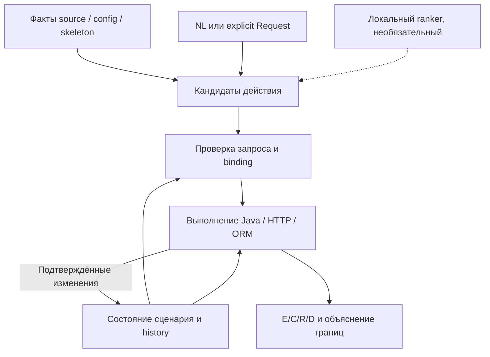

# №31: что исправлять дальше и где проверять пользу моделей для кода

**Дата проверки: 19 октября 2026 года.**  
**Основной материал:** `solution_31_typed_collection_continuations_analysis_v2.zip`.  
**Статус работы:** инженерное исследование, чтение исходников и пересчёт сохранённых данных. Реализация следующей очереди не начата.

## 1. Решение

**Продолжать текущее Python-ядро №31, сначала исправить конкретные потери значений и неверные продолжения выполнения. Модель подключать только как отдельный эксперимент выбора кандидатов для NL, после замораживания данных и сравнения с улучшенным поиском без ML. Переписывание всего ядра, замена scheduler и встраивание тяжёлого SAST сейчас не обоснованы.**

Первая очередь:

1. **R01 — чтение и ограниченная инициализация static-полей из исходников.** Сейчас тип computed static поля известен, но его значение не доходит до потребителя. В TT это проявляется в вычисляемом ключе JWT; это отдельная проблема от действительно отсутствующих admin credentials или токена.
2. **R02 — согласовать нативный контракт `List.indexOf` с типом результата и преобразованием аргументов.** В известном поисковом запросе индекс вычисляется, но при присваивании `int` превращается в unknown. Следующий `List.get` получает неизвестный индекс, создаёт лишнюю неопределённость и портит состояние. Это происходит раньше заявленного конечного препятствия `Set<Ticket>`.
3. **R03 — устранить ложное нормальное продолжение после неподдержанной или повторной Stream-операции и исправить `Optional.isEmpty`.** Поддержка `Stream.toList()` уже сделана; повторять её не нужно. Положительную поддержку `forEach` следует отличать от исправления безопасной остановки.

Затем — ограниченная модель source/generated equality/hash для Set, локализация последствий границ анализа и порядок результатов ORM. Работа над данными для retrieval может идти параллельно, поскольку она не требует смены семантики ядра.

**Для будущего первого ML-сравнения выбираю `nomic-ai/CodeRankEmbed` и `Qwen/Qwen3-Embedding-0.6B`.** Первый проверяет пользу компактного специализированного code retriever, второй — многоязычного представления, включая русский NL. Условный третий кандидат — текстовая часть `google/embeddinggemma-2` после проверки совместимости runtime. Это выбор экспериментов, а не рейтинг качества на нашем проекте. Веса в этом исследовании не скачивались; измерений этих моделей на нашем оборудовании нет.

### Почему очередные улучшения не превращаются в сильный общий результат

Здесь совпали несколько разных причин.

- **Исправляется локальная семантика, а полный сценарий зависит от всей цепочки.** Успех позднего Map/Stream-потребителя бесполезен для пути, который раньше потерял вход, тип индекса, токен или состояние таблицы.
- **Точнее обозначенная граница может уменьшить предсказанный граф.** G03 убрал необоснованное продолжение неизвестного foreach. В S6 исчезли рёбра позднего участка. Возвращать трактовку unknown как пустой коллекции ради прежнего числа рёбер нельзя.
- **Потеря знания распространяется слишком широко.** `AnalysisBoundary` приводит к инвалидированию потенциальных записей всей входной функции. После объединения альтернатив неизвестными становятся таблицы, от которых зависят следующие запросы.
- **Проверки пока неодинаковы по силе.** Большой набор тестов полезен для конкретных контрактов, cart подтверждает содержательную цепочку, но скрытого полного oracle нет, нового реального holdout нет, а часть проверок графа задаёт только обязательные рёбра.
- **Новый слой retrieval не исправит эти причины автоматически.** Он может лучше найти нужный обработчик, но не восстановит доказанный `int`, не исполнит callback и не определит, какая запись действительно произошла.

Это не вывод «№31 бесполезен». В cart получен существенный результат с реальным переносом состояния, remote, типами, ошибками и producer lineage. Но он показывает работоспособность определённого профиля, а не завершённость переносимого продукта.

### Сравнение направлений

| Направление | Что оно решает сейчас | Цена и риск | Решение |
|---|---|---|---|
| Развитие №31 точными source/native контрактами | Есть конкретные места исправления static, List, Stream, Optional; сохраняются готовые HTTP/ORM/state механизмы | Умеренная локальная работа, обязательные проверки aliases, throws и межшагового состояния | **Основной путь** |
| Улучшение индекса и лексического NL-поиска | Латинский tokenizer и обрезка source по символам; качество кандидатов и отказа | Небольшое изменение слоя, отдельная разметка и измерение | **Делать до embeddings или параллельно семантическим исправлениям** |
| Компактный retriever поверх того же индекса | Возможный выигрыш на перефразировании и русском NL | Загрузка модели, память, runtime, неоднозначность; выигрыш для графа не доказан | **Условный измеряемый пилот, по умолчанию выключен** |
| Reranker | Может переставить ограниченный список уже найденных кандидатов | Дополнительный inference; способен ухудшить ранжирование; не возвращает отсутствующего кандидата | После доказанного retrieval bottleneck |
| Новое общее ядро/полный CFG-IR/worklist | Потенциально более системные состояния и summaries | Переписывание уже работающих native carriers, HTTP/ORM, событий, alias/exception machinery; большой объём повторной проверки | Отложить до доказанного препятствия, которое нельзя локально устранить |
| Sonar/Qodana/CodeQL как основной движок | Извлечение фактов, потоки данных, проверки дефектов | Другой целевой контракт, JVM/зависимости/лицензии; нашего многошагового состояния не предоставляет | Заимствовать методы и тестовые идеи; сейчас не встраивать |
| GNN или генеративный planner | Возможные структурные признаки или гипотезы действий | Нет проверенного checkpoint под наши E/C/R/D, нужны данные и новая верификация; больше возможностей выдумать значения | Не первая очередь |

**Уверенность высокая** в локализации описанных code-level дефектов и пересчёте сохранённых множеств. **Уверенность ограниченная** в размере будущего выигрыша: нет выполненных новых MRE, нового полного TT-прогона, скрытых эталонов или локальных ML-измерений. Исправление R01–R03 не является обещанием успешной всей цепочки booking/payment или определённого score.

## 2. Какие данные проверены и что именно означают числа

### 2.1. Целостность и происхождение

В этом документе `V31` обозначает каталог `/workspace/scratch/3c507d34b0c5/review31_input/solution_31`, `A31` — его `code/analyzer`, `TT` — `/workspace/scratch/3c507d34b0c5/analysis_input/tt-challenge/targets/trainticket`. Краткие пути внутри таблиц относятся к этим явно указанным корням. Переходы к важным исходным файлам даны как ссылки; номера строк относятся к поставленной версии.

Проверенный SHA-256 внешнего ZIP:

`b207e214e795fa5a7a88a0729b5ccb36ec2f1a54cd5f8a66180a8afc118e02d5`.

Собственное безопасное чтение ZIP и файлов подтвердило:

- 5 587 ZIP members, без дубликатов, traversal-путей и символических ссылок;
- **5 586 из 5 586** записей корневого manifest совпали;
- **3 854 из 3 854** файлов во всех 15 stage code manifests совпали;
- G01 code/submission соответствуют фактическому №30 из доступного предыдущего пакета;
- текущий inference-код соответствует принятому `G16-report-fastpath`.

Оценённый `V31/solution.zip` содержит 281 файл, включая 269 файлов `code/` и ноль файлов `checks/`. Его SHA-256:

`90ff2b37dca5abf020865ea7d8a851d058f243634d3b753d2c5e4cfa42acf894`.

Весь inference-код и `submission.json` внутри него совпали с current. Различаются две документации после оценки: `README.md` и `IMPLEMENTATION_REVIEW.md`. Текущие `FINAL_REVIEW.md` и `IMPLEMENTATION_REVIEW.md` побайтно одинаковы. Поэтому current-коду можно приписывать **сохранённые** результаты этой посылки, но нельзя называть их воспроизведёнными в данном исследовании.

Из 1 153 protected TT-путей доступны 1 151, все они совпали, включая 1 129 файлов target. Два вспомогательных исторических файла отсутствуют; доступные skeleton, context и сценарии сопоставимы. Основания: [MANIFEST.json](sandbox:/workspace/scratch/3c507d34b0c5/review31_input/MANIFEST.json), [protected-files.json](sandbox:/workspace/scratch/3c507d34b0c5/review31_input/solution_31/development/protected-files.json), [PACKAGE_OMISSIONS.json](sandbox:/workspace/scratch/3c507d34b0c5/review31_input/solution_31/PACKAGE_OMISSIONS.json), [REPRODUCE.md](sandbox:/workspace/scratch/3c507d34b0c5/review31_input/solution_31/REPRODUCE.md).

**Что выполнено мной:** распаковка, SHA/CRC/manifest-сверки, собственные stdlib JSON/gzip/set/AST-сравнения, чтение кода и публичных первоисточников.  
**Что не выполнено:** присланные анализаторы, Python tests/checkers, Java/JVM, сервисы, сборки, Docker, команды из журналов, скачивание весов, inference моделей и обучение. Новые примеры далее — спецификации будущих проверок и статические выводы, а не результаты запусков.

### 2.2. Сайт и открытый S0

| Показатель | №30 | №31 | Смысл |
|---|---:|---:|---|
| Сохранённый общий score сайта | 0,37269 | 0,39232 | Рост на 0,01963; не наш новый прогон |
| Сохранённый S6 сайта | 0,43871457 | 0,37967987 | Снижение на 0,05903470 |
| Сохранённый S5 сайта | 0,29841313 | 0,29841313 | Без изменения |
| Открытый S0 | 0,8008928571428572 | 0,8008928571428572 | Собственно пересчитан по сохранённым JSON; разработческий эталон |
| Восстановленный №5 | — | 0,90987 | Отдельная специализированная историческая ветвь; повторного аудита её переносимости здесь нет |

Для №31 сохранены S1 = 0,43284093; S2 = 0,36126784; S3 = 0,45315187; S4 = 0,38424834; S5 = 0,29841313; S6 = 0,37967987; S7 = 0,43666662. Среднее согласуется с округлением общего score. Источники: [site-score.json](sandbox:/workspace/scratch/3c507d34b0c5/review31_input/solution_31/benchmark/site-score.json), [site-best-restored.json](sandbox:/workspace/scratch/3c507d34b0c5/review31_input/solution_31/benchmark/site-best-restored.json). Сайт заново не открывался, скриншоты визуально не исследовались. Исключённые server/best ZIP нельзя заново сравнить по байтам; их равенство остаётся сохранённым свидетельством.

Пересчёт открытого S0 одинаков для всех 15 стадий:

| Отношение | Pred | Gold | TP | FP | FN | IoU |
|---|---:|---:|---:|---:|---:|---:|
| executes | 30 | 34 | 29 | 1 | 5 | 0,828571 |
| calls | 15 | 24 | 15 | 0 | 9 | 0,625000 |
| remote | 0 | 0 | 0 | 0 | 0 | 1,000000 |
| data | 7 | 7 | 6 | 1 | 1 | 0,750000 |

`remote=1` здесь возникает из двух пустых множеств и **не подтверждает межсервисный анализ**. S0 использовался при разработке и не входит в итог сайта. В отсутствие gold S1–S7 нельзя пересчитать hidden TP/FP/FN по отношениям или назвать конкретное потерянное ребро правильным.

### 2.3. Все сохранённые стадии №31

E/C/R/D — сумма количеств рёбер соответствующего типа по восьми сценарным графам S0–S7; внутри каждого сценария рёбра дедуплицированы. Одинаковая calls/remote/data-связь в разных сценариях учитывается несколько раз. Это counts, не precision.

| Стадия | E/C/R/D | Всего | S6 E/C/R/D | Что видно в сохранённом основном ответе |
|---|---|---:|---|---|
| G01-parent30 | 738/676/94/137 | 1645 | 116/98/18/16 | Родитель |
| G02-bulk-contract-only | 735/673/93/136 | 1637 | 113/95/17/15 | Отдельная абляция на родителе, 8 удалений S6 |
| G03-unknown-foreach | 714/644/85/131 | 1574 | 107/86/14/15 | Основная линия теряет все 26 новых union-рёбер S6 |
| G04-bulk-consumers | 714/644/85/131 | 1574 | 107/86/14/15 | Общий TT-ответ не изменился |
| G05A-cast-soundness | 714/644/85/131 | 1574 | 107/86/14/15 | Исправление proof не изменило общий ответ |
| G05B-commuting-removals | 714/644/85/131 | 1574 | 107/86/14/15 | То же число и множество рёбер |
| G05B2-known-reads | 714/644/85/131 | 1574 | 107/86/14/15 | То же |
| G08-stream-materialization | 714/644/85/131 | 1574 | 107/86/14/15 | Польза проявляется в cart; TT-ответ тот же |
| G09B-mvc-source-absence | 714/644/85/131 | 1574 | 107/86/14/15 | То же |
| G10-source-patch-deployment | 714/644/85/131 | 1574 | 107/86/14/15 | То же |
| G11-source-record-reduce-response | 714/644/85/131 | 1574 | 107/86/14/15 | То же |
| G13-live-route-filter | 789/729/100/141 | 1759 | 107/86/14/15 | Продвинул другие сценарии; S6 не восстановился |
| G16-parent30-paired | 738/676/94/137 | 1645 | 116/98/18/16 | Контроль стоимости родителя |
| G16-candidate-final | 789/729/100/141 | 1759 | 107/86/14/15 | Кандидат перед ускорением записи |
| G16-report-fastpath | 789/729/100/141 | 1759 | 107/86/14/15 | Принятый итог |

Все stage submissions самостоятельно разобраны. Все 24 comparison JSON проверены на внутреннюю согласованность; для доступных полных baseline/final заново рассчитаны witnesses. Для промежуточных стадий некоторые per-step множества восстанавливались из сохранённых deltas: отсутствующие полные traces это не восстанавливает.

Нулевое изменение основного TT-ответа не обесценивает, например, исправление PATCH для другого приложения. Но называть его улучшением TT по этому evidence нельзя. И наоборот, дополнительные рёбра G13 ещё не означают, что каждое из них — hidden TP.

### 2.4. Тесты и стоимость

Числа прошедших проверок имеют разную область:

- **1894** — сохранённые tests из оценённого ZIP;
- **1953** — сохранённый основной набор code + аналитические checks;
- **1955** — исправленный аналитический пакет v2, включая две дополнительные проверки упаковки/ссылок.

В `benchmark/regressions-final/results.json` сохранены 17 успешных процессных записей. Это не 17 независимых приложений. `G06=experiment_rejected`, `G15=not_run`. `G13=verified` означает принятую локализацию границы; поле `full_NL_search_booking_payment_chain_passed` равно false. Остаточные старые поля bookkeeping в overnight-state не отменяют поздние evidence и не становятся новым runtime-дефектом.

Сопоставимая сохранённая пара стоимости: Python 3.11.9, macOS 15.7.3 ARM64, 12 логических CPU; те же входы и flags, без моделей. Источник: [cost-comparison.json](sandbox:/workspace/scratch/3c507d34b0c5/review31_input/solution_31/benchmark/cost-comparison.json).

| Запуск | Подготовка, с | Анализ, с | Запись отчёта, с | Полное время, с | Peak RSS, байт |
|---|---:|---:|---:|---:|---:|
| G16 parent30 paired | 6,328514 | 67,266877 | 11,488528 | 85,118660 | 459784192 |
| G16 candidate final | 6,859267 | 65,821008 | 25,100920 | 97,817939 | 550944768 |
| G16 report fastpath | 6,646167 | 65,666914 | 17,045513 | 89,395566 | 557957120 |

**№31 нельзя назвать в целом быстрее №30:** анализ немного короче, но полное время и RSS выросли. Изменилась и выполняемая работа. Prepared-повторы 53,787440 и 52,360761 с не включают полную запись отчётов, gold evaluation и sidecars; сравнивать их с полными 85–89 с как ускорение того же процесса нельзя. Отдельная report-only пара 4,231805 → 3,101742 с сохраняет те же 151886969 байт, но это единичная пара без очистки OS cache и статистики повторов. Эти данные не говорят о расходах embeddings.

## 3. Карта текущих ограничений по этапам

Здесь «факт кода» означает вывод из прочитанной реализации; «сохранённый свидетель» — соответствующий trace; «гипотеза» — предполагаемый эффект будущего исправления. Эти уровни не взаимозаменяемы.

| Этап | Что уже есть | Подтверждённая проблема или граница | Как проверить отдельно |
|---|---|---|---|
| Извлечение фактов | Project, типы, Spring routes, source/DTO/UI metadata; 280 контрактов в final | Тип static разрешается, но computed значение не читается; нативные сигнатуры распределены по нескольким веткам | Static owner/initializer MRE; сравнить declared type, runtime kind и storage |
| NL → действие | ContractGrounder, lexical rank, роли и related history selection | Общий tokenizer принимает латинские слова; source обрезается по символам; отказ при неоднозначности ограничен | Русский/английский набор, source-backed labels, hard negatives, no-handler |
| Выбор обработчика | Explicit Request имеет отдельный путь; кандидаты привязаны к source | Первый satisfiable proposal не доказывает, что это намерение пользователя | Фиксированные кандидаты, отдельно correctness первого выбора и abstention |
| Аргументы | Consumer conversions, native kinds, related object/history | List.indexOf теряет int при assignment; отсутствующий login input нельзя восполнять догадкой | Direct/local/return index; producer references и типы; missing-input control |
| Java execution | Ветви, source calls, finite native collections, constraints | Unsupported Stream/reuse возвращает U с normal suffix; обычный Optional.isEmpty ошибочен | Callback/throw/sentinel и empty/present/unknown fixtures |
| Межсервисный перенос | HTTP dispatch, binding, server response, source-configured PATCH | TT search не доходит до части RPC; cart remote проходит лишь в объявленном deployment/security профиле | Отдельно wire request, destination, native args, server/client results и отказ до send |
| ORM и состояние | Начальные rows, saves, associations, transactions, scenario history | Boundary расширяет unknown по entry closure; join теряет корреляции; repository order по умолчанию известен без ORDER BY | Пооперационный first-loss ledger; unrelated rows; два порядка; повторный запрос |
| Пути и объединение | Отдельные normal/throw continuations, совместное копирование aliases, observed-union | Ограничения бюджета; часть итогов — остановленные префиксы; row join может инвалидировать целую таблицу | Paired normal/throw и различающиеся states; budgets как отдельная ось |
| Проекция и диагностика | E/C/R/D, candidate_edges отдельно, source/value witnesses | Формат и непустые множества не доказывают правильность; одно boundary-сообщение ошибочно называет разные причины exhaustion | Exact edge tuples, request/event provenance, сверка категории/причины и полного oracle |

Основные файлы: [portable.py](sandbox:/workspace/scratch/3c507d34b0c5/review31_input/solution_31/code/analyzer/portable.py), [contracts.py](sandbox:/workspace/scratch/3c507d34b0c5/review31_input/solution_31/code/analyzer/contracts.py), [engine.py](sandbox:/workspace/scratch/3c507d34b0c5/review31_input/solution_31/code/analyzer/engine.py), [project.py](sandbox:/workspace/scratch/3c507d34b0c5/review31_input/solution_31/code/analyzer/project.py), [state.py](sandbox:/workspace/scratch/3c507d34b0c5/review31_input/solution_31/code/analyzer/state.py), [paths.py](sandbox:/workspace/scratch/3c507d34b0c5/review31_input/solution_31/code/analyzer/paths.py).

### 3.1. Реальная граница текущего NL-поиска

Текущий CLI создаёт `Project → Frontend → ContractIndex` один раз перед циклом сценариев (`portable.py:34`), затем передаёт `ContractGrounder` и `parser=None`. Нельзя описывать его как работающий через старый model-based код `grounding.py` только по наличию того файла.

`ContractIndex` уже использует handlers, routes, сигнатуры, request fields, UI labels и типы. Однако в `contracts.py:161–162` дополнительный текст — первые 1800 символов Java и 1000 символов UI, а не разбиение по AST и лимиту конкретного tokenizer. `ContractGrounder.step:355–455` обходит ranking, собирает satisfiable proposals и возвращает первую подходящую группу; exact score ties и частные identity-проверки не образуют общего калиброванного отказа.

`contracts.tokens:39` вызывает `baseline_nlp.ntoks:28`, который использует `baseline_closure.toks:174` с латинским regex. **Для чистого русского запроса без латинских фрагментов этот lexical путь не создаёт содержательных токенов.** Это вывод по коду, а не проведённый русский benchmark. Замена regex на Unicode сама по себе не переводит русские слова в английские имена методов, но устраняет искусственно испорченный baseline и позволяет использовать русские source/UI слова, символьные n-граммы и общую лексическую нормализацию.

Независимый будущий контроль: одинаковый смысл действия на русском и английском; правильный controller определяется независимой разметкой, а не предыдущим выбором движка. Отдельно — запрос с точным URL, который должен разрешаться без модели, и неоднозначная фраза, для которой выбирать один handler нельзя. Английские общие глаголы и правила Spring допустимы как общие правила; ручная таблица «бизнес-действие TT → endpoint» — другой, недопустимый механизм.

## 4. Новая S6: что изменилось, почему и чего мы не знаем

### 4.1. Actual №30 → final №31

Собственный пересчёт даёт **248 → 222 union-рёбер S6: 26 удалений, 0 добавлений — 9 executes, 12 calls, 4 remote, 1 data**.

| Уровень | Потеря E/C/R/D | Alternatives №30 → №31 | Наблюдение |
|---|---|---|---|
| Шаг 4 | 1/1/1/0 | 8 → 4 | Раньше 4 returned + 4 budget; теперь все 4 unsupported |
| Шаг 8 | 13/12/3/2 | 16 → 1 | Раньше 8 returned + 8 budget; теперь 1 unsupported |
| Сумма потерь шагов | 14/13/4/2 = 33 | — | Семь рёбер шага 8 сохраняются на других шагах |
| Итоговый union | 9/12/4/1 = 26 | — | Разница 33 и 26 объясняется объединением |

На основной линии все 26 отсутствуют уже в G03; последующие G04–G16 S6 union не изменяют. В отдельной G02-only абляции пропали восемь из этих 26. Это **не исторические шесть JsonUtils-рёбер base→C1**: они уже отсутствуют в actual №30.

Основные evidence: [G01-parent30–G16-report-fastpath comparison](sandbox:/workspace/scratch/3c507d34b0c5/review31_input/solution_31/benchmark/comparisons/G01-parent30--G16-report-fastpath.json), [final TT trace](sandbox:/workspace/scratch/3c507d34b0c5/review31_input/solution_31/benchmark/final/analysis-report.json.gz), [исторический causal-ledger](sandbox:/workspace/scratch/3c507d34b0c5/review31_input/solution_31/benchmark/overnight/G02/causal-ledger-v2/causal-ledger.json), [evidence-path-erratum](sandbox:/workspace/scratch/3c507d34b0c5/review31_input/solution_31/benchmark/overnight/G02/causal-ledger-v2/evidence-path-erratum.json). Erratum исправляет путь evidence, а не переписывает историю исполнения.

Четыре исчезнувшие remote-связи:

- шаг 4: `AdminRouteServiceImpl.createAndModifyRoute → RouteController.createAndModifyRoute`;
- шаг 8: `TravelServiceImpl.getTicketsByBatch → BasicController.queryForTravels`;
- шаг 8: `BasicServiceImpl.checkStationsExists → StationController.queryForIdBatch`;
- шаг 8: `BasicServiceImpl.queryTrainTypeByNames → TrainController.retrieveByName`.

Исчезнувшая из union data-связь — `TrainServiceImpl.retrieveByNames → train_type`. Полный список 26 tuples приведён в приложении A.

### 4.2. Причина изменения предсказания

До поиска S6 проходит admin-шаги. Текущее состояние по сохранённым JSON:

| Шаг | Новая неизвестность |
|---|---|
| 1, admin login | Не установлены конкретные credentials; новых unknown tables ещё нет |
| 2, addStation | station становится unknown в 20 из 32 outcome-записей |
| 3, addTrain | train_type становится unknown в 1 из 4 записей |
| 4, addRoute | Все 4 записи останавливаются на Station107; route, route_distances, route_stations расширяются до unknown |
| 6, addTrip | Station107; в unknown добавляются trip/trip2 |
| 8, search | trips уже неизвестны до входа; одна граница на Travel332, до Basic RPC |

Дроби относятся к сохранённым outcome-записям, а не к вероятностям и не к независимым пользовательским сценариям.

В `engine.execute:1373–1392` G03 больше не объявляет неизвестную membership пустой. Он ставит границу выполнения. На шаге 4 source `StationServiceImpl.queryForIdBatch:105–107` читает станции и входит в foreach; на шаге 8 `TravelServiceImpl:214–215` читает trips, затем `getTicketsByBatch:332` пытается обходить уже неизвестную коллекцию. Basic exchange находится позднее, на строке 347. У итогового S6 он не достигнут.

Точные pointers final: `/scenarios/S6/steps/7/alternatives/0/call_effects/0` — `unknown-foreach-boundary/1` на Travel332; `/data_operations/0` — чтение trip; `/state_before/unknown_tables` — уже потерянные таблицы. В prose шаги считаются с единицы, в JSON — с нуля.

Это подтверждает **механизм уменьшения предсказанного графа**. Но скрытый oracle отсутствует. Поэтому нельзя утверждать, что все 26 удалений неправильны, что «сайт награждает неверный foreach» или что конкретный proposed fix восстановит S6 score. Условный математический вывод при неизменном oracle и формуле IoU: падение score при одних удалениях означает потерю хотя бы одного gold-ребра. Он не указывает, какого именно, и не доказывает реальную выполнимость этого ребра.

### 4.3. Откуда масштаб потери состояния

`Engine.run:380–394` ловит `AnalysisBoundary` и вызывает `fallback(entry)`. `fallback:807–823` берёт потенциальную closure **всей entry**, добавляет candidate edges и инвалидирует возможные writable resources. `paths.join_states:8–39` объединяет unknown tables и при несовпадении строк может терять таблицу целиком.

В историческом ledger первая инвалидизация station, observer event 9, и train_type, event 122, уже классифицированы как **analysis-boundary writable-closure fallback**, а не SQL write. Эти номера принадлежат исторической трассе родителя. Текущий механизм подтверждён исходниками и final states; я не выдаю старый observer за новый инструментированный прогон №31.

Следствие: одна неизвестность в auth/filter может загрязнить знания о более поздней возможной записи; следующий запрос получает не точную строку, а неизвестную таблицу. Это объясняет масштаб, но не разрешает просто отключить invalidation до controller. Неизвестный filter может иметь собственные effects или допустить handler. Нужны phase/completion/footprint с источником доказательства.

Дополнительная диагностическая ошибка: `Engine.run:385` пишет предположение про completion budget при разных `AnalysisBoundary`, включая unsupported. Исправление текста полезно для first-loss ledger, но само по себе не исправляет семантику.

В final всего 103 шага и 887 outcome-записей: 159 returned, 173 uncaught exception, 77 unsupported boundary, 476 completion-budget, 2 binding boundary. **476 — не число разных первопричин.** Повторяются префиксы, исходные состояния и альтернативы завершения. `run_paths` ограничивает обычные alternative choices через `limit=4`, а completion budget считает отдельно, `max(8, limit)`. Сравнивать решения только по числу warnings или alternatives неправильно.

## 5. Два разных TT frontier и конкретные ремонты

### 5.1. Computed static: source содержит значение, но оно не прочитано

В [JWTUtil.java](sandbox:/workspace/scratch/3c507d34b0c5/analysis_input/tt-challenge/targets/trainticket/ts-common/src/main/java/edu/fudan/common/security/jwt/JWTUtil.java), строка 31, поле инициализируется вычислением Base64 от строковых bytes; на строках 119–120 читается неуточнённое имя `secretKey`.

Механизм дефекта:

1. `project.py:117–123` сохраняет в constants только известный `literal_default(initializer)`.
2. Static-типы есть в `static_field_types`, но static исключены из instance `type_fields` (`420–424`).
3. `static_field_declaration:551–577` и `engine.source_type` умеют разрешать часть static-типов.
4. `expression_value:1606–1618` читает local env, enum и instance field. Общего чтения static storage там нет.
5. Вызов static method создаёт пустой `this` (`750–753`); computed initializer не вычисляется через instance initialization.
6. [jjwt.py](sandbox:/workspace/scratch/3c507d34b0c5/review31_input/solution_31/code/analyzer/jjwt.py), `native_call:58–65`, уже содержит ограниченную модель getBytes/Base64. `key:33–39` справедливо останавливается, когда представление ключа неизвестно.

В final S6 шагов 2–3 сохранено `signing key representation is unresolved`. Это унаследованный дефект value evaluation, а не основание вставить секрет TT в библиотечную модель.

Независимый **не запущенный** пример:

```java
class Material {
  private static String encoded =
      java.util.Base64.getEncoder().encodeToString("ab".getBytes());
  static String read() { return encoded; }
  static void change(String v) { encoded = v; }
}
```

При явно заданном профиле default charset UTF-8 первое чтение должно дать `YWI=`; после `change("next")` следующий запрос должен прочитать `next`. Второй независимый сценарий начинает со своего исходного static state. Charset здесь часть контекста: overload `getBytes()` не задаёт его сам.

Правильное место ремонта — owner-qualified static cells в сценарном состоянии и ограниченный initializer evaluator, использующий существующие source/native calls. Нужны declaring owner, shadowing, initialization status, value/kind, версии и участие в clone/join. Полная JVM class initialization, classloaders, reflection и synchronization не нужны: неподдержанные циклы или initializer effects должны давать точную boundary. Основание для общего правила — [JLS 17, раздел 12.4](https://docs.oracle.com/javase/specs/jls/se17/html/jls-12.html#jls-12.4), проверено 19.10.2026.

**Исправление ключа не доказывает успешный admin login.** Неизвестные username/password и отсутствующий producer токена остаются неизвестными входами. Их нельзя подбирать из БД по желаемой роли.

### 5.2. Known-input search: List.indexOf ломается раньше Set<Ticket>

[BasicServiceImpl.java](sandbox:/workspace/scratch/3c507d34b0c5/analysis_input/tt-challenge/targets/trainticket/ts-basic-service/src/main/java/fdse/microservice/service/BasicServiceImpl.java), строки 281–282 и 295:

```java
int indexStart = route.getStations().indexOf(info.getStartPlace());
int indexEnd = route.getStations().indexOf(info.getEndPlace());
distance = route.getDistances().get(indexEnd)
         - route.getDistances().get(indexStart);
```

В [G13 known search probes](sandbox:/workspace/scratch/3c507d34b0c5/review31_input/solution_31/benchmark/overnight/G13/tt-generated-setter-consumer/probes.json) **все восемь** alternatives уже проходят `native-map-noop/1` на Basic219 и `native-map-removal/1` на живом Basic242, включая guards 244/252. Старую претензию «Basic242 не выполняется» к этому состоянию применять нельзя.

Дальнейшая цепочка:

- `Engine.call:2962–2963` через `collection_membership:3456–3458` умеет вернуть конкретный index или −1.
- `source_type:2241–2247` задаёт List get/set/remove/size, но не indexOf; [native_contracts.py](sandbox:/workspace/scratch/3c507d34b0c5/review31_input/solution_31/code/analyzer/native_contracts.py) также не закрывает его.
- Нативная ветка не устанавливает нужный runtime kind. `source_reference_kind:958–965` и `assignment_value:1066–1074` превращают значение в U: unresolved unboxing source для `int`.
- `get(U)` не проходит точную int-ветку `3270–3273` и становится opaque call, хотя receiver всё ещё имеет тип `List<Integer>`.
- Это зафиксировано в `/cases/0/alternatives/{0..7}/call_effects/2`: Basic295:49, `opaque-java-call/1`, normal/throw и invalidated heap roots.

Четыре normal-продолжения затем достигают Set<Ticket>; четыре throw-продолжения заканчиваются completion budget. Это один известный поисковый запрос с повторными префиксами и порядками, а не восемь независимых цепочек. Другие warnings в префиксе возможны; установлена общая индексная причина первого opaque get, а не отсутствие любых earlier unknown.

Независимый **не запущенный** MRE:

```java
List<String> names = Arrays.asList("North", "South");
List<Integer> offsets = Arrays.asList(0, 12);
int pos = names.indexOf("South");
return offsets.get(pos);
```

Ожидание: pos=1 типа int, return=12 с корректным unboxing. Для отсутствующего имени pos=−1, следующий get даёт соответствующий bounds failure, а не успешный unknown. Direct/local/return варианты должны совпадать. User-defined `indexOf` с другим возвращаемым типом нельзя превращать в int по имени.

`lastIndexOf` — отдельный контракт: обратный обход, последний индекс, порядок source equality callbacks и throws. Одного добавления сигнатуры недостаточно. Для Integer/Long/Boolean совпадение Python-значений не заменяет Java equality. [List API](https://docs.oracle.com/en/java/javase/17/docs/api/java.base/java/util/List.html), проверено 19.10.2026.

### 5.3. Следующая граница Set<Ticket>

В [OrderServiceImpl.java](sandbox:/workspace/scratch/3c507d34b0c5/analysis_input/tt-challenge/targets/trainticket/ts-order-service/src/main/java/order/service/OrderServiceImpl.java), `54–70`, source создаёт HashSet и добавляет `new Ticket(...)`. [Ticket.java](sandbox:/workspace/scratch/3c507d34b0c5/analysis_input/tt-challenge/targets/trainticket/ts-common/src/main/java/edu/fudan/common/entity/Ticket.java) — Lombok `@Data` с int/String-полями. [java_sets.py](sandbox:/workspace/scratch/3c507d34b0c5/review31_input/solution_31/code/analyzer/java_sets.py), `37–40`, явно отклоняет non-null ключи за пределами native scalar kind, даже при первом add в пустой Set.

Это честная граница модели. Существующие scalar copy/dedup работают и проверены сохранёнными тестами. List membership уже умеет некоторые source equals/default Lombok leaf-контракты, но это не готовая HashSet-модель: нужны hashCode, collisions, equality, callback effects/throws и mutable key behavior.

Рекомендуемое расширение: доказанный source/generated pure equals/hash для ограниченных leaf DTO с известными полями, разрешённой настоящей annotation identity и поддержанными options. Unsupported наследование, arrays, custom options или mutable-key режим не следует незаметно заменять structural dict equality.

Независимый будущий набор — складские ключи `(aisle, bin)`: два разных equal объекта; unequal с одинаковым hash; null; equals/hash throw; callback counter; мутация ключа через alias; одноимённая чужая annotation. Set должен соблюдать исходниковый контракт и отражать source callbacks, где их ID существуют в skeleton. Lombok-generated метод без входного ID не разрешает выдумывать новый идентификатор графа.

**Сначала исправить индекс, затем оценивать Set.** Иначе «продвижение за Ticket» может происходить уже на испорченной opaque-get ветви.

### 5.4. Payment должен использовать реальный wire и реальных producers

В [client_order_list.js](sandbox:/workspace/scratch/3c507d34b0c5/analysis_input/tt-challenge/targets/trainticket/ts-ui-dashboard/static/assets/js/client_order_list.js), `payMyOrder:112–151`, сериализуются **только `orderId` и `tripId`**. `price` сохраняется во view, но в `info` не включён; `userId` этот UI не отправляет. Authorization строится из `sessionStorage.client_token`.

[InsidePaymentServiceImpl.pay](sandbox:/workspace/scratch/3c507d34b0c5/analysis_input/tt-challenge/targets/trainticket/ts-inside-payment-service/src/main/java/inside_payment/service/InsidePaymentServiceImpl.java), начиная со строки 46, действительно читает userId из DTO, а цену — из полученного Order. Это возможное несогласование приложения, которое анализатор обязан отразить по доступным source/binding правилам. Исправлять приложение добавлением userId/price в предсказанный payload нельзя.

`tt-frontier.json` содержит isolated payment probes и явно отрицает успешную полную NL search → booking → payment цепочку. Проба на существующем исходном заказе не доказывает получение orderId из только что выполненного booking. Требование следующей проверки: login/token → search result → выбранная поездка → booking result → реальный UI payload → payment → повторное чтение, со ссылками на каждого producer и состоянием до/после. Если credentials или промежуточный result не установлены, итог должен показывать эту границу.

## 6. Что cart действительно доказал и какие Stream-дефекты остались

### 6.1. Принятый профиль cart содержателен, но ограничен

В [explicit.json](sandbox:/workspace/scratch/3c507d34b0c5/review31_input/solution_31/benchmark/regressions-final/cart/explicit.json) и [nl.json](sandbox:/workspace/scratch/3c507d34b0c5/review31_input/solution_31/benchmark/regressions-final/cart/nl.json) пересчитаны все восемь шагов. Граница прямо объявлена: `application_after_authentication`, `security_evaluated=false`. Все 99 frozen-файлов и отдельно все 90 Java/pom/properties-файлов совпадают с №30.

| Шаг | Сохранённый результат |
|---|---|
| 1 | GET платежей order11 возвращает payment21 APPROVED и payment23 REJECTED |
| 2 | Refund выбранного payment21; только payment21 APPROVED→REFUNDED и order11 PAID→PENDING |
| 2, remote | PATCH в order-service, правильные port/path, Long=11; server body содержит order11/PENDING/total12.50/details31 при клиентском Void |
| 3–4 | Перечитываются обновлённые payment21 и order11; total = 6.25 × 2 |
| 5 | Повторный refund → 409; нет нового write и remote |
| 6 | ID999 → 404; нет write и remote |
| 7 | Неоднозначное действие → ноль handlers; состояние не меняется |
| 8 | Повторное чтение сохраняет payment21 REFUNDED и payment23 REJECTED |

В каждой completed alternative `unknown_tables=[]`. Все прочие поля/строки сохранены; кардинальности payment/order/details — 3/2/2. Значения ID в NL имеют реальные ссылки на history producer, а native Long подтверждён request witness, не только JSON int. Explicit и NL начинают независимо с исходных rows.

В каждом union — **66E/90C/1R/6D**; все 18 required edges сохранены, v3 добавляет 15 per-step executes obligations. Все 47 сохранённых мутаций, 23 explicit и 24 NL, отвергнуты; hashes проверены. Это чтение и собственный пересчёт результатов, без повторного запуска checkers.

Что это не доказывает:

- полный precision/IoU всех 163 рёбер не размечен;
- security/login/session journey не проверен;
- NL-профиль смешанный: часть шагов уже содержит explicit HTTP;
- источник cart уже использовался при настройке;
- проверка final rows не исключает любую возможную лишнюю промежуточную запись с последующим восстановлением;
- единая глобальная хронология всех source/HTTP/SQL/callback events не имеет полного независимого oracle.

[cart_evaluator_v3.py](sandbox:/workspace/scratch/3c507d34b0c5/review31_input/solution_31/checks/cart_evaluator_v3.py), `62–112`, и [run_cart_profile.py](sandbox:/workspace/scratch/3c507d34b0c5/review31_input/solution_31/checks/run_cart_profile.py), `53–70`, подтверждают область проверки. Обязательные рёбра v2 не удалены из v3. Отказ считать unchanged children отдельной физической UPDATE при cascade/save имеет предметное основание: cascade не доказывает SQL UPDATE каждой неизменённой строки.

### 6.2. Что уже реализовано и сохраняется

`Engine.stream_call:3460–3557` и [native_storage.py](sandbox:/workspace/scratch/3c507d34b0c5/review31_input/solution_31/code/analyzer/native_storage.py) реализуют последовательную материализацию toList: отдельный immutable контейнер, ссылки на элементы, native kinds, неизвестность порядка, opaque membership и callbacks. Проверены тела тестов `test_stream_materialization.py`, `test_java_streams.py`, `test_typed_reduce_records.py`: null, aliases, source.clear, immutable mutation, HashSet permutations, callback throws, boxing и interference.

Optional.map, source-specific MVC exception handler, правильные servlet arguments, PATCH с доказанной request factory/deployment, typed records и sequential reduce уже есть. Cart дошёл до полного профиля совокупностью этих исправлений. `BigDecimal` работает в ограниченной Decimal-модели с отдельной scale metadata; это не полная Java BigDecimal.

Source/configured PATCH основан на `RestTemplate`/`RestOperations`, нативном client carrier и доказанной factory. В cart известны environment completeness, default profile, loopback deployment и уникальный порт. Это условный Spring/deployment adapter, а не Spring bootstrap. Сохранять проверки Simple/unknown factory, одинаковых портов и unknown environment обязательно.

### 6.3. Дефект S-1: unsupported terminal пропускает callback

`Engine.call:2993–2996` сразу возвращает обработанный результат `stream_call`. Для неподдержанного operation `stream_call:3495–3498` возвращает U; callback не вызывается, captures не инвалидируются, consumption не устанавливается. Общий unknown-effect handler не достигается.

Независимый **не запущенный** MRE:

```java
List<Integer> touched = new ArrayList<>();
Arrays.asList(1).stream().forEach(x -> touched.add(x));
return touched.size();
```

При нормальном выполнении terminal forEach ожидается 1. Статический разбор нынешних веток даёт normal continuation с известным 0. Неизвестный результат void-call проигнорирован, поэтому «вернуть U» здесь не представляет неопределённость effects.

Это унаследованный пробел; current cart его не использует, причинность hidden score не установлена. Для ремонта есть два разных результата:

- **Корректность границы:** unsupported callback operation прекращает необоснованное нормальное продолжение с объяснением.
- **Положительная поддержка:** finite sequential known-order forEach реально вызывает source callback, переносит captures, effects и throw; этот результат требует отдельных положительных тестов.

Не следует выдавать первую часть за внедрение forEach. Не следует слепо вызывать `apply_unknown`: при receiver Stream footprint часто unscoped, а текущая callback-ветка распознаёт lambda, но не все method references. [call_effects.py](sandbox:/workspace/scratch/3c507d34b0c5/review31_input/solution_31/code/analyzer/call_effects.py), `71–126`.

Нормативная основа: [Stream API Java 21](https://docs.oracle.com/en/java/javase/21/docs/api/java.base/java/util/stream/Stream.html), проверено 19.10.2026. MRE намеренно использует forEach: правило не нужно распространять на произвольные intermediate callbacks в map/peek+count, которые реализации могут устранять при допустимой оптимизации.

### 6.4. Дефект S-2: известный reuse не прекращает continuation

`stream_call:3475–3478` при consumed/linked предупреждает и возвращает U. Тест `test_java_streams.py:59–64` проверяет U второго terminal как возвращаемое значение; он не проверяет следующую запись.

Новый **не запущенный** контроль:

```java
Stream<Integer> s = Arrays.asList(1).stream();
s.toList();
s.toList();
touched.add(9);
```

Нельзя подтверждать последний add как обычное продолжение после заведомо недопустимого повторного потребления. Для доказанного стандартного native lifecycle нужен корректный non-normal outcome; точный IllegalStateException — только в установленном поддержанном контракте реализации. Общая Java API говорит о возможности обнаружения reuse, поэтому не надо приписывать точный throw любому пользовательскому Stream.

Обязательная пара: catch IllegalStateException с собственным effect и последующая достижимая операция после catch. Проверить linked alias, две ссылки на один stream и независимый второй stream. Guard нельзя менять на unconditional throw для всех методов carrier: наблюдатели вроде `isParallel` и lifecycle operations требуют отдельных descriptors.

### 6.5. Дефект S-3: Optional.isEmpty на обычном empty carrier

`models.py:374–377` и `Optional.map` создают обычный carrier с отсутствующим value. В `engine.py:3219–3222` специальный isEmpty есть только для `__repository_presence__`; затем общий `isEmpty:3226–3231` проверяет сам непустой словарь carrier и получает false.

Независимый **не запущенный** MRE:

```java
return Optional.empty().map(x -> x).isEmpty();
```

Ожидается true. Текущие map tests проверяют isPresent, а current cart absence использует orElseThrow, поэтому этот баг не отменяет успешный cart профиль.

Нужен общий presence-контракт для factories, repository и mapped Optional: empty/present/unknown; null mapper проверяется в правильной последовательности; mapper→null даёт empty. Нельзя исправлять все методы с именем isEmpty независимо от receiver. [Optional API Java 21](https://docs.oracle.com/en/java/javase/21/docs/api/java.base/java/util/Optional.html), проверено 19.10.2026.

### 6.6. Порядок ORM — отдельный следующий риск

`PaymentJpaRepository.findByOrderId:25` возвращает List без OrderBy/Sort/ORDER BY. `Engine.repository:4018` создаёт `JavaList()`, у которого по умолчанию `order_known=True` (`native_storage.py:103`). Для associations отдельная логика unknown order уже есть; для общего repository List она не перенесена.

В cart payment21 — единственный APPROVED, поэтому выбор этой записи не зависит от перестановки. Неправильность текущего ID из этого факта не следует. Но independent сценарий «изменить первую запись из двух подходящих» должен либо учитывать допустимые порядки, либо останавливаться с неопределённостью. Положительный контроль — source ORDER BY.

Цена исправления включает history/checkers: `normalize_nl:45` пока записывает journal только при одной alternative; explicit runner требует согласия producers. Ослабление до «взять первую alternative» уничтожит проверку. Поэтому ORM order — отдельный follow-up, а не незаметное дополнение к Stream patch.

## 7. Что взять из статического анализа и материалов видео

### 7.1. Точная граница просмотра

[Видео Simple Automation](https://www.youtube.com/watch?v=DlEZzDiJH1E) и [страница расшифровки](https://youtubetotranscript.com/transcript?v=DlEZzDiJH1E) в этом исследовании не отдали доступное содержание. Аудио, слайды и полный transcript мной не просмотрены. Фраза в присланном промте о прочитанной расшифровке относится к подготовке промта, а не к выполненной мной работе. Метки времени из запроса использованы только как навигационные ориентиры.

Через публичный GitHub доступен исходный репозиторий **`ivanovec/java-basics`, commit `601628d54fdb0496bb56632ee1a03909e3d39222`**. Прочитаны девять satests, две inspection KTS, custom.ql, qodana.yaml и sonar-project.properties. Дерево содержит 875 entries. У HugeSwitchExplosion прочитаны первые 40 строк, все закомментированы; он не объявляется выполненным benchmark. Содержание исходников не подменяет видео.

### 7.2. Проверенные идеи и независимые контрпримеры

Источник таблицы — [satests на проверенном commit](https://github.com/ivanovec/java-basics/tree/601628d54fdb0496bb56632ee1a03909e3d39222/src/main/java/simple/automation/satests); пути классов — `src/main/java/simple/automation/satests/`. Проверка содержания выполнена через file API, а не запуск Java.

| Прочитанный пример | Фактическая идея исходника | Контроль для нашего ядра |
|---|---|---|
| FlowSensitivityTest | Значение меняется в ветке; последующее использование видит новое значение | Guard до присваивания не переживает изменение local |
| ObjectSensitivityTest | b=a; запись через b изменяет значение, читаемое через a | Alias одного объекта и два разных объекта одного типа |
| InterProceduralTest | Возврат/nullable значение проходит через вызовы | Normal/throw/null summary с контекстом аргументов |
| PathSensitivityTest | Проверка null защищает использование внутри ветки, но не вне неё | else, ранний return и слияние путей |
| WideningTest | Цикл пишет за размер массива; есть растущий числовой диапазон | Интервал, bounds, termination и явное widening |
| FinallyBlockTest | Dereference расположен в finally | Effect и exception order при return/throw |
| ContextSensetivityTest | Несколько реализаций payment-like объекта; null return | Не смешивать разные receiver types; в примере CreditCard не implements Payment |
| ContextSensitivityServletTest | Request-derived и constant значения имеют разное происхождение | Внешний input не становится константой от похожего контекста |
| PathSensitivityReduntTest | Условие с OR может быть всегда истинным | Дизъюнкция и корректное отрицание условия |

В учебных KTS найденные мной ограничения **не являются автоматически новыми дефектами №31**:

- Array inspection использует инверсию сравнения и как отрицание, и как перестановку операндов; это разные операции. Для `10 > i` перестановка даёт `i < 10`, а не `i <= 10`.
- При отрицании сложного условия нужны законы де Моргана; нельзя отрицать листья, оставляя AND/OR прежними.
- Поиск ближайших условий по тексту не инвалидирует guard после присваивания.
- `lastLiteralBeforeUsage` выбирает первое подходящее предыдущее literal, а не гарантированно последнее reaching definition.
- Имена массивов используются без полноценной symbol identity.
- Nullness inspection ограничивается отдельными assignment/method-return формами; visited recursion и объединение returns не заменяют контекстный heap analysis.
- `custom.ql` сопоставляет синтаксис loop/index/bound, но это не полное доказательство, что конкретный access находится на нужном пути без промежуточной записи.

Источники: [ArrayOutOfBoundInspection.inspection.kts](https://github.com/ivanovec/java-basics/blob/601628d54fdb0496bb56632ee1a03909e3d39222/inspections/ArrayOutOfBoundInspection.inspection.kts), [PotentialNullDereferenceInspection.inspection.kts](https://github.com/ivanovec/java-basics/blob/601628d54fdb0496bb56632ee1a03909e3d39222/inspections/PotentialNullDereferenceInspection.inspection.kts), [custom.ql](https://github.com/ivanovec/java-basics/blob/601628d54fdb0496bb56632ee1a03909e3d39222/custom.ql). Проверено 19.10.2026. Их полезно превратить в независимо сформулированные expected outcomes; переносить учебные обходы в production не нужно.

### 7.3. Что из этих механизмов уже есть в №31

`constraints.py:91–183` уточняет часть Boolean/scalar locals, сравнения с literals, интервалы и исключённые значения. `engine.py:1354–1370` исполняет известную ветку либо делает choice и `assume`. Это не «последний if выше по тексту». Однако домен не является общим relational solver над heap, aliases и полями; запись guard в trace не всегда означает доказанную истинность.

[heap_join.py](sandbox:/workspace/scratch/3c507d34b0c5/review31_input/solution_31/code/analyzer/heap_join.py), `clone_execution:70–88`, копирует state и параметры совместно. `fork_join:838–926` включает env, браузер, beans, history, params и managed objects в roots. Singleton adoption и canonical caller identities уже есть; старую проблему потерянного singleton continuation нельзя предлагать исправить повторно.

`map_loop_proof` и `map_filter_proof` — существующие bounded summaries: известные native containers, source AST, контроль purity/read roots/alias, отсутствие незапланированных effects и подтверждённые коммутирующие удаления. Их успех на Basic242 — причина сохранить этот подход, а не автоматически распространить его на произвольные циклы и callbacks.

### 7.4. Небольшой абстрактный домен полезнее необоснованного полного rewrite

Для следующего scoped summary достаточно явно задать абстрактное состояние:

```text
type / native kind
nullness: null | non-null | maybe-null
scalar: constant | finite alternatives / interval | unknown
collection: size interval, membership, encounter order
object: known fields, mutable locations, alias identities
completion: normal | throw(type) | unsupported/budget boundary
provenance: source/input/history origin and approximation cause
```

Последняя строка — объяснение знания, а не дополнительное доказательство значения. Unknown, null, absent field, известная пустота и неполная membership остаются разными состояниями.

Порядок точности можно задать через concretization: `a ⊑ b`, если `γ(a) ⊆ γ(b)`; справа допускается больше реальных состояний и меньше известно. `⊥` — недостижимость, `⊤` — полная неизвестность в домене. Join строит надприближение объединения, например объединение возможных типов или hull интервалов; guard сужает только свою ветку. Assignment заменяет reaching value и убирает несовместимые старые ограничения; запись по alias инвалидирует относящиеся к той же location facts.

Если появится локальный worklist, его ключ должен включать source program point, ограниченный call context и состояние; изменившийся вход повторно передаётся в transfer. Для конечной итерации нужны конечная высота домена либо widening с доказанным прекращением роста: например, ограниченное множество constants/aliases и перевод растущего интервала к бесконечной границе. **Одна монотонность не гарантирует конечной итерации произвольного бесконечного домена.** Бюджет обхода гарантирует остановку вычисления, но не полноту результата.

Основания: [Cousot & Cousot, POPL 1977](https://www.di.ens.fr/~cousot/COUSOTpapers/POPL77.shtml), [Clang Data Flow Analysis Intro](https://clang.llvm.org/docs/DataFlowAnalysisIntro.html), проверено 19.10.2026. Это заимствование метода, не предложение встроить Clang для Java. Перечисление домена также не доказывает soundness всех текущих transfer-функций №31.

Первый summary разумно ограничить source-pure utility или projection по доказанному native контейнеру. В ключе нужны source/version, аргументы с kind, alias pattern, read locations и версии. В результате — return value/alias, normal/throw, reads/writes и source events. Изменились preconditions/read versions — обычное выполнение или boundary. Любой неизвестный callback с возможной записью запрещает объявить метод pure по имени.

Для уменьшения entry-wide fallback недостаточно описать callback: нужно охватить **всё оставшееся продолжение** после границы, включая возможные вызовы handler и finally. Начинать следует с first-loss/footprint instrumentation и одного доказуемого случая. Сокращение unknown за счёт пропуска effects не принимается.

### 7.5. Почему G06 не надо переименовывать в новую архитектуру

В [residual_state_pilot.py](sandbox:/workspace/scratch/3c507d34b0c5/review31_input/solution_31/checks/residual_state_pilot.py) проверялось повторное использование **завершённых независимых calls**, а не suspended Java continuations.

Сохранены все шесть order witnesses; commuting и datastore-effect: 15 → 12 engine calls; order-dependent: 15 → 15; throwing: 3 → 3. Проверены 11 различий ключа, включая actor, DB revision, clock, completion, source, kinds, order и aliases. Remote в этом пилоте пуст.

Это полезный отвергнутый эксперимент. В нём нет полного контракта frames, активных transactions, browser/NL history и межсервисных наблюдений. Его вывод `experiment_rejected` сохраняется. Новый summary/cache-пилот потребует нового свидетельства повторяемых эквивалентных состояний и observational equality, а не нового имени. Ни R01, ни R02, ни R03 от него не зависят.

## 8. Внешние движки и модели: роли, ограничения и выбор

Все публичные сведения в этом разделе проверялись **19.10.2026** по карточкам, конфигурациям, коду и публикациям авторов. Здесь нет собственных inference-, latency- или memory-измерений. Число параметров и размер опубликованных файлов не равны RSS/VRAM. В поисковые запросы приватные фрагменты исходников не отправлялись.

### 8.1. Классические инструменты

| Инструмент/метод | Что даёт | Какие входы и зависимости нужны | Пригодность и цена для нашей задачи |
|---|---|---|---|
| Текущее Python-ядро + точные native/source summaries | Значения, ветви, effects, HTTP/ORM, scenario state и skeleton IDs в уже поддержанном профиле | Source/config/skeleton/context; существующий parser/runtime | Наименьшая цена закрытия установленных дефектов. Главные риски — неполные transfer contracts и coarse join |
| CFG/dataflow, abstract interpretation | Program points, reaching facts, domains, join/widening, межпроцедурные summaries | Корректные symbol/CFG/alias/library facts; source adapter | Применять локально. Метод сам по себе не предоставляет Spring, SQL или NL |
| CodeQL Java | База фактов, local/global dataflow, taint paths, query-based анализ | CLI/database/extractor, JDK; Java none/autobuild/manual; отдельные лицензии | Полезен как внешний сравнительный источник фактов в иной разрешённой среде. Не заменяет наш execution/state contract |
| Qodana JVM | IDE inspections, дефекты и межпроцедурные проверки в поддержанном профиле | IDE/JDK-платформа, разрешение project dependencies; native или контейнерный запуск | Можно брать идеи проверок. Тяжёлый runtime не обоснован как зависимость переносимого Python-анализатора |
| SonarJava | Rules, типовая информация, symbolic-execution проверки дефектов | Для проекта больше одного Java-файла документация требует compiled classes; scanner/JRE и project dependencies | Не укладывается в текущий source-only эксперимент без JVM/сборок; отчёт SAST не является scenario oracle |

**CodeQL.** Документация различает local/global dataflow и taint: это достижимость потока по модели, а не конкретная последовательность запросов с DB state. Java `build-mode=none` существует, но документация прямо описывает попытки запускать Maven/Gradle для dependency information. «None» не означает отсутствие JVM или любых project commands и не удовлетворяет нынешнему запрету сам по себе. Без сборки теряются generated code и точность dependencies. CLI имеет отдельные условия использования/распространения; открытая query library не делает полный движок свободной встраиваемой зависимостью.

Источники: [Java dataflow](https://codeql.github.com/docs/codeql-language-guides/analyzing-data-flow-in-java/), [build options](https://docs.github.com/en/code-security/reference/code-scanning/codeql/build-options-for-compiled-languages), [CLI availability](https://docs.github.com/en/code-security/concepts/code-scanning/codeql/codeql-cli), [CLI LICENSE](https://github.com/github/codeql-cli-binaries/blob/main/LICENSE.md). Собственная память/стоимость CodeQL не измерена.

**Qodana.** Текущая документация 2026.2 допускает native Linux/macOS/Windows: утверждение «обязательно Docker» уже неверно. В deployment guide указаны минимум 2 GB свободной RAM, рекомендуемые 8 GB системной памяти и от 2.5 GB диска плюс зависимости/cache; это требования авторов, не наш RSS. JVM-профиль основан на IntelliJ/JDK и разрешает Maven/Gradle dependencies. Community linters доступны с отдельными условиями; открытость CLI не доказывает permissive-лицензию всей платформы.

Источники: [deployment](https://www.jetbrains.com/help/qodana/deploy-qodana.html), [JVM](https://www.jetbrains.com/help/qodana/jvm.html), [community/contributors](https://www.jetbrains.com/help/qodana/contributors.html). Не запускалась.

**SonarJava.** Современный repository README относит релизы анализаторов после 29.11.2024 к **SSALv1**; blanket-утверждение о прежней LGPL неверно. Условия включают ограничения конкурирующего использования, поэтому без проверки применимости нельзя планировать свободное встраивание полного движка. Это описание условий, а не юридическое заключение о конкретном продукте.

Источники: [Java analysis requirements](https://docs.sonarsource.com/sonarqube-community-build/analyzing-source-code/languages/java), [SonarJava repository](https://github.com/SonarSource/sonar-java), [LICENSE](https://github.com/SonarSource/sonar-java/blob/master/LICENSE.txt). Собственный runtime/RSS не измерен.

**Архитектурный вывод:** нынешние дефекты не требуют замены parser/IR тяжёлым инструментом. Начать с нативных сигнатур, source storage и корректных completion; результат этих работ даст факты для решения, нужен ли вообще новый слой CFG. В этом продолжении не выполнялся новый сравнительный прогон Joern/Infer/WALA/Soot/Mopsa/Gillian или прежнего каталога из 90 компонентов; приписывать ему свежие результаты нельзя.

### 8.2. Четыре разных класса learned-компонентов

| Класс | Реальный выход | Допустимая роль | Почему он не заменяет семантику |
|---|---|---|---|
| Bi-encoder embeddings | Вектор запроса и source document; similarity | Найти contract/UI/handler-кандидатов | Близость текстов не определяет значения, ветку или write |
| Reranker | Score пары запрос–кандидат | Переставить небольшой top-k | Не создаёт отсутствующего кандидата и не подтверждает его выполнение |
| Graph/AST/DFG models | Структурное представление или предсказание обученной задачи | Дополнительный retrieval control, если структура действительно помогает | Pretraining edges/VarMisuse labels не являются E/C/R/D сценария |
| Генеративная локальная модель | Текст/JSON/план | В будущем — предложения с обязательным source/input binding | Синтаксически корректный JSON может содержать выдуманный handler, ID, токен или условие |

### 8.3. Компактные кандидаты первого сравнения

В следующей таблице «Java/NL» — граница опубликованных свидетельств, не измерение нашего продукта. Для всех моделей **русский бизнес-сценарий → Java/Spring entry → правильный граф не проверен**. CPU/Mac ARM, ONNX и квантование не считаются подтверждёнными только по названию architecture или наличию стороннего export.

| Модель и источник | Происхождение, вход → выход | Контекст, pooling, chunking | Лицензия, runtime, цена | Решение и проверка пользы |
|---|---|---|---|---|
| [CodeRankEmbed](https://huggingface.co/nomic-ai/CodeRankEmbed) | `nomic-ai/CodeRankEmbed`; 137M, специализированный code/NL bi-encoder на основе Arctic Embed; text/source → dense vector | 8192; авторский query prefix и штатный custom encoder; длинные методы делить по AST, не усреднять произвольные куски | MIT; PyTorch/Transformers/SentenceTransformers, custom `nomic_bert`; опубликованный файл около 547 MB, RSS неизвестен | **Первый пилот.** Проверить code-retrieval gain поверх сильного lexical baseline, отдельно русский и English |
| [Qwen3-Embedding-0.6B](https://huggingface.co/Qwen/Qwen3-Embedding-0.6B) | `Qwen/Qwen3-Embedding-0.6B`; около 596M; multilingual text/code → vector | Заявлено 32K; example 8192 — другой лимит; last non-pad token + L2, 1024 dims, MRL 32–1024; instruction для query | Apache-2.0; Transformers ≥4.51, SentenceTransformers ≥2.7 по card; локальные BF16 weights; RSS/CPU/MPS не измерены | **Второй пилот.** Русский NL и парафразы, одинаковый corpus/chunk budget; не приписывать 0.6B результаты 8B |
| [EmbeddingGemma 2](https://huggingface.co/google/embeddinggemma-2) | `google/embeddinggemma-2`; релиз 06.10.2026; 740M total, 270M text configuration; text/code → embedding | 8192; mean/projection до 768 dims, MRL; отдельный code-retrieval prefix | Apache-2.0; новый runtime, в card нет закреплённой минимальной версии; text-only configuration исключает vision/audio modules, но опубликован общий файл около 1.49 GB | **Условный третий.** Сначала pin/runtime audit; 270M text не доказывает cold peak и цену загрузки |
| [C2LLM-0.5B](https://huggingface.co/codefuse-ai/C2LLM-0.5B) | `codefuse-ai/C2LLM-0.5B`; около 497M, из Qwen2.5-Coder; retrieval, не генеративный planner | Config 32768; adaptive PMA attention pooling, compressed dim 896; нельзя заменить на mean/last-token | Apache-2.0; custom code импортирует PEFT и DeepSpeed utilities, использует внутренние Transformers helpers; default FlashAttention2; около 995 MB weights | Резерв после двух простых controls. Проверить точный pooling и переносимый runtime; невозможность CPU не доказана, готовность тоже |

Для EmbeddingGemma 2 дополнительно проверены [официальный анонс](https://blog.google/innovation-and-ai/technology/developers-tools/embeddinggemma-2/) и [developer guide](https://developers.googleblog.com/embeddinggemma-2-the-developer-guide/). Она не смешивается с `embeddinggemma-300m`.

У C2LLM изучен [modeling_c2llm.py](https://huggingface.co/codefuse-ai/C2LLM-0.5B/blob/main/modeling_c2llm.py): PMA — реальная attention pooling implementation. Наличие импортируемых training-oriented dependencies повышает цену упаковки offline runtime. Это более конкретное препятствие, чем размер 0.5B. Публичная [статья C2LLM](https://arxiv.org/abs/2512.21332) описывает retrieval; перенос на наше состояние не следует из неё.

### 8.4. Ориентиры, альтернативы и причины отложить

| Checkpoint/источник | Роль, Java/NL evidence | Контекст/pooling | Runtime, условия и стоимость | Решение |
|---|---|---|---|---|
| [microsoft/graphcodebert-base](https://huggingface.co/microsoft/graphcodebert-base) | Code + DFG representation; Java есть в авторском code search; downstream setup/fine-tuning отдельно; NL benchmark преимущественно English | Model limit 512; авторский поиск разделяет code/DFG/NL budgets и применяет graph-guided attention + RoBERTa pooler | PyTorch/Transformers/Tree-sitter и parser library; repository MIT, отдельные weight terms в HF card не установлены | Структурный контроль после доказанного retrieval failure, не первый zero-shot retriever |
| [microsoft/unixcoder-base](https://huggingface.co/microsoft/unixcoder-base) | Cross-modal code representation; encoder-only text/code retrieval | Wrapper default 512, ограничение max_length <1024; masked mean, L2 | HF Apache-2.0; авторский wrapper MIT; PyTorch/Transformers; около 504 MB FP32 файла | Небольшой исторический baseline при необходимости, не обязательная третья загрузка |
| [Salesforce/codet5p-110m-embedding](https://huggingface.co/Salesforce/codet5p-110m-embedding) | Отдельный encoder 110M + projection; опубликован Java zero-shot retrieval, не генеративная модель 2B/16B | 256 dims; first token → Linear → L2; проверенный длинный limit не установлен | Custom code, PyTorch/Transformers; около 439 MB файла. YAML BSD-3-Clause, README research-only — несогласованность условий | Технически компактный control; до product use уточнить условия |
| [jinaai/jina-code-embeddings-0.5b](https://huggingface.co/jinaai/jina-code-embeddings-0.5b) | Из Qwen2.5-Coder-0.5B; пять code retrieval task families, 15+ PL не равны 15+ NL | 32768 declared, example8192; last-token, 896 dims/MRL | CC-BY-NC-4.0; Transformers ≥4.53, torch ≥2.7.1; FlashAttention optional; около 988 MB BF16 | Исследовательский резерв; условия распространения продукта не решены |
| [jinaai/jina-code-embeddings-1.5b](https://huggingface.co/jinaai/jina-code-embeddings-1.5b) | Та же retrieval family, около 1.54B, отдельный checkpoint | 32768 declared; last-token, 1536 dims/MRL | CC-BY-NC-4.0; те же runtime requirements; около 3.09 GB weights | Отложить: дороже, local benefit не подтверждён |
| [Salesforce/SFR-Embedding-Code-400M_R](https://huggingface.co/Salesforce/SFR-Embedding-Code-400M_R) | Code/text retriever, около 434M; в CodeXEmbed есть Java experiments | Config8192, 1024 dims, **CLS + L2**, не mean | CC-BY-NC-4.0 + research-only; custom `auto_map` на внешний `Alibaba-NLP/new-impl`; около 868 MB BF16 | Резерв исследования; отдельно pin и аудит внешнего кода |
| [Salesforce/SFR-Embedding-Code-2B_R](https://huggingface.co/Salesforce/SFR-Embedding-Code-2B_R) | Gemma-derived retriever, около 2.61B | Last-token, 2304 dims; example32768 против config8192/sliding4096 | NC/research-only и Gemma terms; custom helper принудительно использует CUDA и внутренний from_pretrained; около 5.23 GB BF16 | Не первый переносимый pilot; long-context и CPU/MPS путь не подтверждены |
| [nomic-ai/nomic-embed-code](https://huggingface.co/nomic-ai/nomic-embed-code) | Большой code retriever из Qwen2.5-Coder-7B; Java retrieval опубликован | 32768, 3584 dims, last-token + L2, query prefix | Apache-2.0; около 28.3 GB опубликованных FP32 файлов; память при иной dtype/quantization отдельно | Только последующий дорогой reference, если компактные модели полезны, но ограничены |
| [Qwen/Qwen3-Reranker-0.6B](https://huggingface.co/Qwen/Qwen3-Reranker-0.6B) | Query+document → yes/no-based relevance score; около 596M | 32K declared; actual pair budget фиксировать отдельно | Apache-2.0; около 1.19 GB weights; card имеет SentenceTransformers 5.4 integration | Условная абляция top-k после retriever; не default |
| [hq-bench/coreb-code-reranker](https://huggingface.co/hq-bench/coreb-code-reranker) | Code reranker на Qwen3-Reranker-4B; LoRA training, опубликованный merged model | Пример max4096; размер окна примера не proof качества длинных пар | Apache-2.0; около 4.02B и 8.04 GB merged weights, не маленький adapter | Отложить по цене и отличию задач benchmark |
| [Qwen/Qwen2.5-Coder-1.5B-Instruct](https://huggingface.co/Qwen/Qwen2.5-Coder-1.5B-Instruct) | Causal generation, около 1.54B; возможные текст/JSON-гипотезы | 32768; generative tokenizer/template, не embedding pooling | Apache-2.0; Transformers support ≥4.37; около 3.09 GB weights; наши latency/RSS неизвестны | Не включать в первую очередь: нет доказательства выигрыша в grounded planning |

Точные byte-level условия offline deployment требуют pin tokenizer, config, pooling, custom code и зависимостей, а не только ID модели. `trust_remote_code=True` при будущей загрузке — исполнение конкретного Python-кода; его надо предварительно проверить, сохранить локально и исключить runtime network. Наличие ONNX-файла или чужого quantization repo не является доказательством корректного экспорта, CPU/Mac скорости и сохранения качества.

**Reranking может ухудшить результат.** В авторской контролируемой таблице [CoREB](https://huggingface.co/hq-bench/coreb-code-reranker), при одном C2LLM-7B first stage, Qwen3-Reranker-0.6B имеет отрицательные изменения на трёх группах задач, а специализированный CoREB — положительные. Это опубликованный опыт авторов на другом corpus, не результат нашего стенда. Он достаточен, чтобы требовать отдельную абляцию, но недостаточен для выбора CoREB для продукта. [Статья](https://arxiv.org/abs/2605.04615).

### 8.5. Что GraphCodeBERT действительно делает

[Статья GraphCodeBERT](https://arxiv.org/abs/2009.08366) описывает переменные и статический data flow в pretraining, graph-guided attention и representation tasks. «Предсказание edges» там не означает предсказание микросервисных executes/calls/remote/data по конкретным данным.

Прочитан оригинальный `GraphCodeBERT/codesearch/parser/DFG.py`, функция `DFG_java:180–354`, Git blob SHA `61e0179d2112b726b2da725bccaeca9fe1364d20`. States индексированы именами, assignments связывают token positions, if объединяет states, enhanced-for/while обходятся по AST ограниченное число раз. Это representation preprocessing, а не heap/DB/exception semantics. Две одноимённые локальные переменные в разных scopes и `b=a; b.value=2; read(a.value)` — полезные разделяющие controls.

Авторский [code-search runner](https://github.com/microsoft/CodeBERT/tree/master/GraphCodeBERT/codesearch) требует конкретного extract_dataflow, masks, token/DFG budgets и task setup. Некоторые parser failures дают пустой DFG. Простое mean pooling `AutoModel` не воспроизводит опубликованный graph-aware метод; score task-finetuned версии нельзя приписывать base checkpoint.

Если впоследствии появится обоснованный структурный pilot, сравнивать нужно graph-aware и token-only вариант **с одинаковым task checkpoint/training budget**, corpus и truncation diagnostics. Иначе выигрыш от дообучения ошибочно назовут выигрышем DFG.

### 8.6. GNN и поиск за пределами исходного списка

[Learning to Represent Programs with Graphs](https://arxiv.org/abs/1711.00740) исследует **VarNaming и VarMisuse**. В статье используются C# projects и Roslyn для graph/type extraction; граф включает AST/LastUse/LastWrite/ComputedFrom. Это другой стек, другие входы и другие labels. Авторский [GGNN sample](https://github.com/Microsoft/gated-graph-neural-network-samples) и dataset — материал для метода, а не готовый Java/Spring scenario checkpoint. Сходно названный `microsoft/graph-based-code-modelling` относится к другой работе; эти репозитории нельзя смешивать.

Чтобы учить свою graph model на E/C/R/D, понадобятся независимо размеченные request/state-conditioned graph labels, отрицательные paths, mutations и разделение по приложениям. Малое число настроенных TT/cart oracle не поддерживает заявление о переносимости. Training, graph extraction, annotation и evaluation обойдутся дороже первого retrieval-пилота; checkpoint под нужный контракт не найден и не проверен.

Дополнительно вне отправного списка исследованы:

| Кандидат | Что нового предлагает | Почему не расширяю первый pilot |
|---|---|---|
| [codesage/codesage-small-v2](https://huggingface.co/codesage/codesage-small-v2) | 130M representation/retrieval, Java NL2Code в авторских результатах; Apache-2.0, custom code; около 256 MB файла | Перекрывает компактный code-control; Russian/Spring не проверены; надёжный runtime context limit получить не удалось. [Код авторов](https://github.com/amazon-science/CodeSage) |
| [naver/splade-code-06B](https://huggingface.co/naver/splade-code-06B) | Learned sparse retrieval, разреженные признаки в vocabulary space; статья 2026 года | Это ML, а не BM25-baseline; CC-BY-NC-SA-4.0 и custom SparseEncoder. Выигрыш поиска по миллиону документов не переносится на 280 контрактов. [Статья](https://arxiv.org/abs/2603.22008) |

Ни один найденный дополнительный checkpoint не даёт доказательств, что именно он снимет текущие execution/state bottlenecks. Поэтому эксперимент не расширяется до скачивания всего каталога.

### 8.7. Зафиксированные revisions для воспроизводимого будущего выбора

Ниже — полные наблюдённые HF commits. Дата проверки всех строк — **19.10.2026**. Это metadata pin, не hash скачанных в этом исследовании весов. В будущем manifest должен дополнительно фиксировать реально полученные файлы и версии runtime.

| Model ID | Revision |
|---|---|
| nomic-ai/CodeRankEmbed | [3c4b60807d71f79b43f3c4363786d9493691f8b1](https://huggingface.co/nomic-ai/CodeRankEmbed/commit/3c4b60807d71f79b43f3c4363786d9493691f8b1) |
| Qwen/Qwen3-Embedding-0.6B | [97b0c614be4d77ee51c0cef4e5f07c00f9eb65b3](https://huggingface.co/Qwen/Qwen3-Embedding-0.6B/commit/97b0c614be4d77ee51c0cef4e5f07c00f9eb65b3) |
| google/embeddinggemma-2 | [914f7f89142e33e77833254d9c9b90c3cef7303b](https://huggingface.co/google/embeddinggemma-2/commit/914f7f89142e33e77833254d9c9b90c3cef7303b) |
| codefuse-ai/C2LLM-0.5B | [bd6d0ddb29f0c9a3d0f14281aedc9f940bb8d67a](https://huggingface.co/codefuse-ai/C2LLM-0.5B/commit/bd6d0ddb29f0c9a3d0f14281aedc9f940bb8d67a) |
| microsoft/graphcodebert-base | [2b0488a7bb0eefc7041f1bb2cad1ab26b0da269d](https://huggingface.co/microsoft/graphcodebert-base/commit/2b0488a7bb0eefc7041f1bb2cad1ab26b0da269d) |
| microsoft/unixcoder-base | [5604afdc964f6c53782a6813140ade5216b99006](https://huggingface.co/microsoft/unixcoder-base/commit/5604afdc964f6c53782a6813140ade5216b99006) |
| Salesforce/codet5p-110m-embedding | [d9f3a534af4252f04b10cd9f78e05037542d10f6](https://huggingface.co/Salesforce/codet5p-110m-embedding/commit/d9f3a534af4252f04b10cd9f78e05037542d10f6) |
| jinaai/jina-code-embeddings-0.5b | [4db235132dafbe56a8b9c5f59b59795ecf58a4a7](https://huggingface.co/jinaai/jina-code-embeddings-0.5b/commit/4db235132dafbe56a8b9c5f59b59795ecf58a4a7) |
| jinaai/jina-code-embeddings-1.5b | [39aeb4fb9b60f930934c78ae5d749a46287c248a](https://huggingface.co/jinaai/jina-code-embeddings-1.5b/commit/39aeb4fb9b60f930934c78ae5d749a46287c248a) |
| Salesforce/SFR-Embedding-Code-400M_R | [cb950dc80d677c6fdc00f56c8ddd20ca2642c59e](https://huggingface.co/Salesforce/SFR-Embedding-Code-400M_R/commit/cb950dc80d677c6fdc00f56c8ddd20ca2642c59e) |
| Salesforce/SFR-Embedding-Code-2B_R | [c73d8631a005876ed5abde34db514b1fb6566973](https://huggingface.co/Salesforce/SFR-Embedding-Code-2B_R/commit/c73d8631a005876ed5abde34db514b1fb6566973) |
| nomic-ai/nomic-embed-code | [11114029805cee545ef111d5144b623787462a52](https://huggingface.co/nomic-ai/nomic-embed-code/commit/11114029805cee545ef111d5144b623787462a52) |
| Qwen/Qwen3-Reranker-0.6B | [e61197ed45024b0ed8a2d74b80b4d909f1255473](https://huggingface.co/Qwen/Qwen3-Reranker-0.6B/commit/e61197ed45024b0ed8a2d74b80b4d909f1255473) |
| hq-bench/coreb-code-reranker | [24d2ad50bb4a53149cfd3c42c0e966e954cdbcf1](https://huggingface.co/hq-bench/coreb-code-reranker/commit/24d2ad50bb4a53149cfd3c42c0e966e954cdbcf1) |
| Qwen/Qwen2.5-Coder-1.5B-Instruct | [2e1fd397ee46e1388853d2af2c993145b0f1098a](https://huggingface.co/Qwen/Qwen2.5-Coder-1.5B-Instruct/commit/2e1fd397ee46e1388853d2af2c993145b0f1098a) |
| codesage/codesage-small-v2 | [4844c2f24b25e181aa43ca058cc73dd2622565c1](https://huggingface.co/codesage/codesage-small-v2/commit/4844c2f24b25e181aa43ca058cc73dd2622565c1) |
| naver/splade-code-06B | [e53a0b8bd312d83955598a392dc826b3fc4028f7](https://huggingface.co/naver/splade-code-06B/commit/e53a0b8bd312d83955598a392dc826b3fc4028f7) |

Дополнительные источники для деталей, где одного model card недостаточно: [UniXcoder wrapper](https://raw.githubusercontent.com/microsoft/CodeBERT/master/UniXcoder/unixcoder.py), [CodeT5 embedding forward](https://huggingface.co/Salesforce/codet5p-110m-embedding/blob/main/modeling_codet5p_embedding.py), [SFR400 config с внешним auto_map](https://huggingface.co/Salesforce/SFR-Embedding-Code-400M_R/resolve/main/config.json), [SFR400 pooling](https://huggingface.co/Salesforce/SFR-Embedding-Code-400M_R/blob/main/1_Pooling/config.json), [SFR2B config](https://huggingface.co/Salesforce/SFR-Embedding-Code-2B_R/resolve/main/config.json), [SFR2B encode helper](https://huggingface.co/Salesforce/SFR-Embedding-Code-2B_R/blob/main/modeling_gemma2.py), [Qwen3 Embedding report](https://arxiv.org/abs/2506.05176).

## 9. Рекомендуемая граница компонентов

### 9.1. Целевой поток

Сохраняется существующее разделение проекта и сценария; новый компонент ограничен ranking. Пунктир — условный будущий эксперимент.



ML получает только представления source documents и текста действия. Он не получает доступ к evaluator gold, hidden score или функции записи графа. Статическое ядро проверяет candidate identity, HTTP contract, значения и результат исполнения. Токен и объект предыдущего шага приходят из history/browser, а не из retrieval response. Условные эффекты остаются привязанными к guards/alternatives; observed-union ограниченного обхода не превращается в доказательство полного множества возможных выполнений.

### 9.2. Что индексировать

Один логический документ — source-backed contract или UI action site. Полезные поля:

| Поле | Откуда берётся и зачем |
|---|---|
| Canonical contract ID, handler ID, optional UI site ID | Только входной skeleton и source resolution; общий ключ для lexical/dense результатов |
| Module, fully qualified owner, signature, annotations | Различают одноимённые методы, services, overloads и framework roles |
| HTTP method, path template, request/response types | Строгие факты запроса; исключают похожий GET вместо PATCH |
| DTO fields и их объявленные типы | Помогают найти source contract; не дают права выдумывать значения |
| UI label/callback, route construction, storage access | Связывают пользовательское действие с реальным запросом |
| Небольшой source context и разрешённые непосредственные соседи | Дают смысл методу без превращения документа в весь сервис |
| Path, line span, file/source hash, adapter/schema version | Проверяемая provenance и invalidation |
| Truncation/chunk metadata | Показывают, какая часть метода действительно попала в encoder |

Для длинного метода сохранять сигнатуру/owner/route и делить тело по AST-блокам. Chunk budget задаётся tokenizer конкретной модели; нельзя выдавать первые 1800 символов за одинаковое окно всех encoders. Кандидат агрегируется по canonical contract ID, а source span сохраняется. Соседи выбираются по фиксированному source-derived правилу, не по известному правильному ответу.

Корпус для retrieval содержит только исходные факты. Сценарный запрос может ссылаться на уже известный тип/поле history, но приватные значения БД не должны превращаться в обучающий корпус. Если annotation/комментарий обещает бизнес-эффект, это текстовый сигнал; подтверждать эффект всё равно должен source execution.

### 9.3. Точный контракт learned-адаптера

Предлагаемый результат:

```json
{
  "query_id": "opaque-local-id",
  "candidates": [
    {
      "contract_id": "existing-source-backed-id",
      "chunk_ids": ["existing-chunk-id"],
      "rank": 1,
      "scores": {"lexical": 0.0, "dense": 0.0},
      "evidence_spans": ["existing-source-span-id"]
    }
  ],
  "model_revision": "pinned-revision-or-disabled",
  "corpus_digest": "digest",
  "truncated": false
}
```

Числа здесь — схема, не пороги. Из learned-ответа запрещено напрямую получать:

- E/C/R/D или достижимость source statement;
- Java true/false, runtime kind и поле DTO;
- SQL write или статус транзакции;
- значение неизвестного callback;
- actor identity, credential, session token;
- конкретный ID из БД без input/history provenance.

Grounder должен отдельно вернуть accepted binding, ambiguous или no grounded request с причинами. Каждое значение имеет источник: literal из запроса, source default, context fact, history reference или unresolved. Совместимость с DTO не доказывает намерение пользователя. Если два кандидата допустимы и различаются смыслом, их нельзя тихо свести к одному из-за cosine.

Для explicit HTTP модель полностью обходится. Известные HTTP method/path constraints и source registration имеют приоритет. Unknown actor не подменяется известной ролью; hard filter по роли допускается лишь при доказанном контексте, иначе это сигнал/неопределённость.

### 9.4. Лексический и плотный поиск

Базовый вариант B: Unicode-aware токены, camelCase/snake_case разбиение, идентификаторы и route segments, annotations, UI labels, BM25 или аналогичный лёгкий ranker. Общие лексические правила допустимы, ручной словарь маршрутов конкретного проекта — нет. Простой межъязыковой словарь, если испытывается, должен быть общим, фиксированным и отдельно маркированным; он не даёт права дополнять payload.

В C dense retrieval ищет по **тому же корпусу**. Слияние rankings, например фиксированный reciprocal-rank fusion, задаётся до holdout. Отдельно измеряются расширение candidate recall и перестановка уже фиксированного candidate set: это разные эффекты. Reranker D видит только ограниченный top-k; его нельзя оценивать на заранее очищенных правильных кандидатах.

### 9.5. Offline, кэш и размер индекса

В TT final 280 контрактов. Если хранить по одному float32-вектору на контракт, сырые значения занимают:

- 768 dims: 280 × 768 × 4 = **860160 байт**;
- 1024 dims: 280 × 1024 × 4 = **1146880 байт**.

Это только арифметика векторов: без chunks, metadata, модели и runtime. Даже с несколькими chunks на метод начинать разумно с локальной матрицы и dot product. **Векторный сервер для первого пилота не нужен.** ANN и сервер обсуждаются только после измеренного роста corpus/latency, а не ради архитектурной полноты.

Project facts/cache зависят от source/config/skeleton digest и версии Java/Spring adapter. Embedding cache дополнительно зависит от model/tokenizer revision, pooling, prefixes, document schema, dtype и chunking. Mutable DB, browser, history, beans и новые static cells принадлежат сценарию; они не должны утекать в общий Project cache.

Fallback без модели всегда доступен. Отсутствие локальных весов не вызывает network и не меняет обработку explicit Request. CPU/Mac ARM runtime принимается только после реального локального smoke/cost/quality сравнения. ONNX, quantization и иная sequence length — самостоятельные варианты с теми же regression gates.

## 10. Протокол честного эксперимента

### 10.1. Сначала данные, потом настройки

Сначала фиксируются корпус, labels, hard negatives и правила оценки; затем выбираются веса и гиперпараметры. Состав моделей в этом документе — предварительный shortlist для планирования. Нельзя подбирать chunks, k, threshold и model по будущему test split, а затем объявлять его holdout.

Предлагаемая структура данных:

| Набор | Назначение | Что требуется |
|---|---|---|
| TT, Piggy, cart, document и существующие MRE | Development/regression | Сохранить реальные ограничения oracle, прежние freeze и provenance |
| Новый реальный Java/Spring проект другой области | Первый transfer holdout | Замороженные source/config/skeleton/context, explicit и NL, независимый oracle до изменения движка |
| Второй реальный проект ещё одной области | Проверка, что решение не настроено на единственный новый проект | Отдельные авторы разметки/слепой test; реальные многошаговые межсервисные effects |
| Малые независимые source fixtures | Локализация механизма | Guard, static, index, equality, alias, callback, normal/throw; полный небольшой oracle |

Например, реальная система аренды оборудования и система согласования документов с двумя сервисами — подходящие **типы задач**, не утверждение о найденных и готовых пакетах. В наличии такого нового полного holdout сейчас нет. Если он не предоставлен/не подготовлен, transfer-эксперимент честно остаётся `not_run`.

В реальных проектах нужны цепочки создания/выбора объекта, изменения состояния, повторного чтения, повторного запроса с отказом, удалённого вызова с ошибкой и неоднозначного действия. Необходимы непустые remote и data, корректные prefixes до отказа и независимые сценарии с разными исходными states. Переименование TT и набор из одних игрушек не подтверждают переносимость.

В пределах текущего запрета на запуск приложений oracle строится по source/config/DB контрактам с независимым инженерным разбором. Сложные неподтверждённые части маркируются как partial; не следует называть их dynamic ground truth. Если позже понадобится реальный execution oracle, это отдельное изменение границ задачи и среды, а не скрытый шаг текущего плана.

### 10.2. Что размечать для retrieval

Единица — действие/шаг с source-backed допустимым множеством contracts и UI sites. Для неоднозначного запроса label может требовать отказ, а для отсутствующего handler — empty set. Positive нельзя получать из выбора текущего движка.

Нужны:

- русский и английский NL, смысловые пары и независимые парафразы;
- одинаковые method names в разных services;
- похожие пути с разными HTTP methods;
- одинаковые DTO fields у разных операций;
- роли/акторы с разным доступом;
- похожие действия с несовместимым текущим состоянием;
- запрос без source handler;
- explicit HTTP controls;
- действия, где ID должен приходить из предыдущего response.

Для калибровки — development split. Test split разделять по приложениям/сценарным цепочкам, а не случайно по соседним перефразировкам одного endpoint. Сильные negatives подтверждаются source, а не создаются только случайной заменой слов.

### 10.3. Абляции A–F

| Вариант | Retrieval | Семантика | Что изолирует |
|---|---|---|---|
| A | Текущий №31 | Текущий №31 | Зафиксированная отправная точка |
| B | Улучшенный поиск без ML | Та же №31 | Пользу индекса/токенизации/лексики |
| C | Корпус B + одна компактная embedding model | Та же №31 | Добавочную пользу dense retrieval |
| D | Лучший retriever + ограниченный reranker | Та же семантика | Цену/выигрыш перестановки top-k; только при обосновании |
| E | Retrieval A | R01–R03, затем отдельно последующие принятые fixes | Чистую пользу семантики |
| F | Принятый retrieval B/C/D | Принятая семантика E | Совместный результат и взаимодействия |

Зафиксировать `path_limit=4`, constraints, completion policy, observed-union и порядок исследования. Каждая смена бюджета/порядка — отдельная диагностическая ось. ML для порядка путей сейчас не предлагается: под прежним лимитом он меняет, какие пути вообще попадут в union. Такое ранжирование потребовало бы отдельного сравнения потерь против доступной reference enumeration и не доказывало бы достижимость.

Нужны также controls «те же кандидаты, иной rank» и «расширенное candidate retrieval»: иначе неясно, модель нашла отсутствующий handler или просто удачно переставила существующий. Размер model context и число chunks фиксируются и логируются; модель не получает весь проект, когда baseline получает только имя метода.

### 10.4. Метрики и обязательные witnesses

| Уровень | Метрики/проверки | Ограничение интерпретации |
|---|---|---|
| Retrieval | Recall@1/3/6, MRR; nDCG при graded labels; top-1 correctness | Значения k — предложение для согласования; ranking gain не равен graph gain |
| Отказ | Coverage–error curve, false accept на ambiguous/no-handler, false reject | Порог калибруется на development, до blind test |
| Binding | Правильные поля, значения, native kinds, source/default/history origin | JSON schema validity недостаточна |
| Execution | Ветви, return/throw, callbacks, prefix/suffix reachability, aliases | Unknown нельзя засчитывать как верное concrete значение |
| HTTP | Actual wire, destination, server binding, request/response pairing, error before/after send | Один remote count недостаточен |
| State/ORM | Полные допустимые rows до/после, versions, повторное чтение, rollback, независимость сценариев | Final state не заменяет ordered effects |
| Граф | E/C/R/D отдельно: TP/FP/FN/IoU при полном oracle | Required-edge coverage при partial oracle не называется precision |
| Диагностика | Первый loss site, original cause, widened locations, completion, budget flags | Число warnings не является целевой функцией |

Отчёт должен содержать per-project/per-language/per-action результаты, размеры denominators и paired errors. Общая средняя не должна скрывать деградацию remote, редких отказов или русского NL. На маленьком наборе публикуются все случаи расхождений; статистические интервалы не делают несколько зависимых парафраз независимыми.

Для первой потери знания сохранять source location, declared type, runtime kind, before/after abstract value, completion и affected locations. Сводить повторяющиеся префиксы по причине, сохраняя число затронутых шагов/цепочек. Это полезнее рейтинга из 476 однотипных budget-записей.

### 10.5. Защита от утечки oracle

- Inference и corpus builder получают только явно разрешённые inputs; gold/evaluator доступны отдельной проверяющей стороне.
- Не индексировать сохранённые predictions, score, labels, solution discussions или документы с ответом на test scenario.
- Не использовать S0–S7 IDs, site score и скрытые ожидания для thresholds, ranking features или восстановления рёбер.
- Fixtures и бизнес-константы в checker допустимы как описание теста; такие константы не переносятся в analyzer.
- Source mutations и парафразы фиксируются до test: изменение guard/route/type/producer должно менять предсказание по механизму.
- Перефразировки одного действия и производные mutations не распределяются между train/dev/test как независимые примеры.
- При уточнении oracle сохранять старую версию, source-обоснование delta и повторный разбор; нельзя молча удалить неудобное expected ребро.

### 10.6. Стоимость

Измерять на одном установленном оборудовании, с закреплёнными OS/Python/torch/Transformers/tokenizer/BLAS/device, threads, batch size, dtype и sequence limits. Отдельные фазы:

1. Извлечение source facts.
2. Загрузка модели и tokenizer.
3. Первичное построение и обновление индекса.
4. Query encoding.
5. Retrieval/reranking.
6. Статический расчёт.
7. Полная сериализация reports и sidecars.

Записывать wall time, peak process/child RSS, disk artifacts, index size; для GPU — allocated/reserved VRAM и тип устройства. Cold/warm определять явно: новый процесс, уже загруженная модель, reuse индекса, состояние OS cache. Пример начального протокола — 5 cold и 10 warm повторов с median/range; **это предложение, а не согласованный норматив**. Не очищенный OS cache не называть полностью холодным I/O.

Отдельно показать batch index throughput и latency одного NL-запроса. Нельзя приписать модели ускорение, если новый запуск исключил запись 150 MB отчёта или пропустил прежние пути. Prepared reuse сравнивается с prepared reuse, полное время — с полным.

### 10.7. Приёмка и отказ

До запуска необходимо согласовать практические бюджеты RAM/VRAM, времени подготовки и одного сценария. Они сейчас не установлены; выдумывать «обязательно <X секунд» нельзя.

Предлагаемые quality gates:

- ноль новых известных семантических нарушений на обязательных exact fixtures;
- explicit requests сохраняют разрешение и wire независимо от model availability;
- false accept на ambiguous/no-handler не ухудшается сверх заранее согласованного допуска;
- retrieval gain воспроизводится на frozen test и проявляется хотя бы в измеримом downstream результате либо убедительном отдельном use case;
- полный граф/состояние не ухудшаются по критическим отношениям и error cases; partial oracle не используется для такого заявления;
- стоимость укладывается в согласованный бюджет при полном измерении;
- offline inference не требует network и дополнительных неучтённых downloads.

Нулевой порог новых известных нарушений — предложенный инженерный gate, не ранее согласованный SLA. Для небольшого набора важнее разбор каждого нового false accept, чем красивый процент.

**Reject:** B не хуже C при меньшей стоимости; C улучшил только настроенный TT; выигрыш достигнут сокращением путей/изменением oracle; runtime/licensing не подходят; reranker ухудшает paired ranking или downstream; model score используется как semantic truth.  
**Not run:** нет нового frozen holdout, нет разрешения на загрузку/установку, нет подходящего оборудования или не удалось зафиксировать безопасный runtime.  
**Verified:** выполнены заранее заданные проверки конкретного scope с artifacts. Исчерпание времени не превращает pending работу в verified.

## 11. Приоритетная очередь R01–R08

Оценка стоимости ниже **предварительная и относительная**. Она описывает объём затрагиваемых механизмов, не измеренные человеко-дни и не обещанный score. Первая реализация ограничена R01–R03; R04–R08 — последующие решения с собственными gates.

### R01. Source static storage и ограниченная инициализация

**Проблема/evidence.** Computed static value не доходит до JJWT (раздел 5.1; Project.constants, static type lookup, Engine.expression_value). Это ранняя причина потери знания; credentials/token рассматриваются отдельно.

**Гипотеза и изменение.** Добавить сценарные owner-qualified cells с value/kind/init status/version, разрешать bare/qualified/static-import по declaring owner, выполнять поддержанный initializer через существующий evaluator. Изменения: `project.py`, `engine.py`, `state.py`, `heap_join.py`, `paths.py`; не хранить mutable values в Project.constants.

**Минимальная проверка.** Material из раздела 5.1: source Base64 initializer → read → change → read, затем независимый сценарий. Отдельно зависимые initializers и случай, когда тип лишь упомянут/class literal: это не повод произвольно выполнять initializer.

**Negative/регрессии.** Local shadowing, одинаковые short names из разных packages, inherited static через Child, разные static поля Base/Child, branch writes, initializer throw/cycle, два aliases mutable объекта. Charset задан; неизвестный admin input остаётся unknown.

**Готово, если** value и kind сохраняются, initialization не повторяется необоснованно, clone/join и независимость сценариев корректны, unsupported класс-инициализация явно ограничена, TT first-loss ledger показывает фактический следующий boundary. **Не готово**, если успех достигнут literal TT, отключением auth или вечным общим cache.

**Зависимости:** baseline/freeze; от R02/R03 не зависит. **Стоимость:** средняя, основной риск — межшаговое состояние и join; полный JVM lifecycle исключён.

### R02. List.indexOf: значение, тип, consumer и bounds

**Проблема/evidence.** Все восемь known search alternatives имеют Basic295 opaque get после потери int на 281–282 (раздел 5.2).

**Гипотеза и изменение.** Единый resolved native signature и runtime kind для List.indexOf(Object)→int; consumer conversions должны видеть тот же контракт. `native_contracts.py`, `source_conversions.py`, `Engine.source_type/call/collection_membership`. `lastIndexOf` добавляется только с отдельной правильной runtime-веткой; нельзя назвать его закрытым одной декларацией.

**Минимальная проверка.** Names/offsets: local/direct/return варианты дают 12; missing даёт −1 и правильный bounds failure на get. Read не меняет контейнер и aliases.

**Negative/регрессии.** Дубликаты/последний индекс, null, Integer≠Long, Boolean≠число, unknown kind/membership/order, custom indexOf, source equals с эффектом/throw и корректным порядком вызовов.

**Готово, если** обе стороны type/value согласованы и новая known search trace больше не имеет потерю индекса как причину Basic295. Следующий Set boundary допустим и должен быть показан. Снижение warnings без сохранённого pos/kind/result не принимается.

**Зависимости:** baseline; можно разработать отдельно от R01. **Стоимость:** малая для indexOf; средняя при расширении lastIndexOf/source callback cases. Не менять глобальные budgets.

### R03. Completion для Stream и presence для Optional

**Проблема/evidence.** `stream_call:3495–3498` пропускает effects; `3475–3478` оставляет normal suffix после known reuse; `3226–3231` даёт неправильный Optional.isEmpty (разделы 6.3–6.5).

**Гипотеза и изменение.** Устранить normal U вместо неподдержанного continuation; разделить terminal/intermediate/observer descriptors. Согласовать Optional presence. Изменения: `engine.py`, `native_contracts.py`, при необходимости `native_storage.py` и callback helpers.

**Минимальные проверки.** ForEach с touched.add; повторный terminal с sentinel и paired catch; Optional.empty().map(...).isEmpty(). Добавить HTTP absence→404 до save и paired present путь.

**Два отдельных результата.** R03-correctness требует честной boundary и правильных reuse/presence outcomes. R03-forEach-support принимается лишь для явно заданного finite sequential known-order подмножества с реальными callbacks; unsupported boundary сама по себе не считается этой поддержкой.

**Negative/регрессии.** Empty/nonempty, `forEach(null)` на обоих, lambda/method reference, alias captures, throw после первого effect, source interference, два разных streams, linked alias, unsupported observer, unknown lifecycle/presence, null mapper. Для positive callback integration — непустые remote и data. Сохранить toList/immutable/reduce/cart.

**Готово, если** не подтверждается невозможный suffix, сохраняются prefix effects и catch behavior; positive support и boundary scope названы отдельно. **Стоимость:** малая для Optional, средняя для Stream continuation/support. Возможный рост unknown из-за текущего entry fallback измерить, а не скрыть.

### R04. Ограниченное source/generated equals/hash для Set

**Проблема/evidence.** Non-scalar Ticket останавливается в `java_sets.call:37–40`; после индексного repair это следующий реальный frontier.

**Гипотеза и изменение.** Доказанное подмножество source/default Lombok leaf equals/hash, с native/source type identity, collisions и completion. `java_sets.py`, equality/generated-model helpers, `engine.collection_membership`, heap metadata.

**Минимальная проверка.** Два разных складских ключа с равными полями → один элемент; unequal с одинаковым hash → два; callback throw не превращается в add success.

**Negative/регрессии.** Mutable keys, arrays, inheritance/callSuper/exclusions, annotation namesake, inconsistent hash/equals, aliases, order. Scalar HashSet и ранее корректные boundaries сохраняются за пределами нового scope.

**Готово, если** независимые tests проходят и новый TT witness показывает продвижение из неповреждённого index path. Общая structural equality по dict — отказ.

**Зависимости:** R02 для TT приёмки. **Стоимость:** средняя/высокая; переносимой value-object модели нужна более строгая граница, чем «поддержать Ticket».

### R05. First-loss diagnostics и один scoped effect summary

**Проблема/evidence.** `Engine.run/fallback` расширяют writable closure всей entry; `paths.join_states` теряет корреляции (раздел 4). Один unknown может испортить следующие запросы.

**Гипотеза и изменение.** Сначала точные причины/фаза/affected locations. Затем один source-proven summary выбранной операции/тела: return/throw/read/write, сохранённый префикс и консервативный учёт ещё не исследованного продолжения. Если безопасное продолжение вне принятого scope, сохранить boundary. Использовать существующий консервативный `resource_effects.possible_writes`, проверяя его предпосылки; его read-name эвристики сами по себе не доказывают отсутствие writes. Новый scheduler не нужен.

**Минимальная проверка.** Два сервиса, известный отказ до write, другой путь с remote read и последующим save; unrelated row сохраняется. Отдельно неизвестный filter, который может писать: его effects нельзя отбросить.

**Negative/регрессии.** Unknown foreach с физически пустым backing; callback write через alias; finally; normal/throw с разными writes; mutable read versions; transaction rollback.

**Готово, если** точность preserved locations улучшилась без пропуска возможных writes и без подтверждённых body edges на одном факте potential closure. Full small oracle содержит непустые remote/data. Если precondition summary не доказана — обычная boundary, `experiment_rejected` для неудачного pilot.

**Зависимости:** новый first-loss ledger после R01–R03. **Стоимость:** высокая; разрешён только один проверяемый scope. G06 не является уже готовой реализацией.

### R06. ORM encounter order и agreement producers

**Проблема/evidence.** Repository List без source ordering получает order_known=True; cart пока маскирует проблему единственным APPROVED (раздел 6.6).

**Гипотеза и изменение.** Перенести отсутствие order proof в carrier; фиксировать порядок только из поддержанного ORDER BY/Sort/association contract. Согласовать alternative-aware NL lineage. `Engine.repository`, `native_storage`, persistence/query metadata, `normalize_nl` и checker.

**Минимальная проверка.** Две подходящие записи из реального repository; действие зависит от первой. Без source order нельзя выбрать один ID как доказанный. С ORDER BY — определённый producer.

**Negative/регрессии.** Перестановка SQL dump, одинаковые sort keys, nullable sort values, пагинация, несколько альтернатив с одним selected ID, разные selected IDs.

**Готово, если** допускаемые порядки и producer agreement проверены без выбора первой alternative и без сортировки по удобному ID. Current cart обязательства сохранены либо source-обоснованно расширены на все легальные порядки.

**Зависимости:** R03 regression gates; отдельная диагностическая ось budgets. **Стоимость:** средняя/высокая из-за NL/history и path multiplicity.

### R07. Frozen retrieval benchmark и сильный вариант B без ML

**Проблема/evidence.** Латинский tokenizer, символьная обрезка и неразмеченная переносимость выбора обработчика (раздел 3.1).

**Гипотеза и изменение.** Unicode/source-fact documents, bounded AST chunks, canonical contract IDs, фиксированный lexical ranker/abstention. `contracts.py`, `baseline_nlp.py`, `baseline_closure.py`; dataset/harness отдельно от inference.

**Минимальная проверка.** Русский/английский набор с duplicate-service methods, wrong HTTP method, ambiguous/no-handler и explicit controls; labels из source до tuning.

**Negative/регрессии.** Нет gold/prediction в corpus; missing history остаётся unresolved; explicit bypass сохранён; source mutation меняет document digest.

**Готово, если** A/B воспроизводимы, опубликованы candidate sets/labels/ошибки и затраты. Без нового полного real holdout transfer-часть остаётся not_run.

**Зависимости:** независимая разметка; можно готовить параллельно R01–R03. **Стоимость:** код малая/средняя; качественные данные — существенная и пока не измеренная работа.

### R08. Условный пилот двух embeddings и, при основании, reranker

**Проблема/evidence.** Только после R07 будет измерено, остаются ли retrieval ошибки, которым может помочь смысловое представление.

**Гипотеза и изменение.** Изолированный offline ranking adapter для CodeRankEmbed и Qwen3-Embedding-0.6B, с pins из раздела 8.7 и тем же corpus. EmbeddingGemma 2 — условный третий. Reranker отдельным D.

**Минимальная проверка.** C против B, затем F против E на frozen data; отдельные русский/English и real project результаты, fallback без весов. Модель не имеет semantic API.

**Negative/регрессии.** Model unavailable, offline network denied, corrupt/mismatched cache, no-handler, одинаковые routes разных actors, парафразы без literal identifiers, source hash change.

**Готово, если** измерены ranking, downstream и полная стоимость; заранее согласованные gates выполнены. Если B равноценен дешевле или C помогает лишь tuned projects — experiment_rejected; при отсутствии данных/runtime/разрешения — not_run.

**Зависимости:** R07, отдельное разрешение на веса/установку, согласованный ресурсный профиль. **Стоимость:** средняя для прототипа; runtime/данные/CPU-Mac валидация пока не измерены. Обучение своей модели не входит.

## 12. Готовые промпты реализации

### 12.1. Первая очередь R01–R03

**Ниже текст для отдельного запроса на реализацию. Он не исполнялся в текущем исследовании.** Он намеренно ограничивает первую очередь R01–R03 и не требует гарантировать рост site score или закрытие всей TT цепочки.

~~~~text
Реализуй первую семантическую очередь по отчёту
solution_31_models_and_static_analysis_review.md: R01–R03.

Рабочая база — исправленный
solution_31_typed_collection_continuations_analysis_v2.zip,
SHA256 b207e214e795fa5a7a88a0729b5ccb36ec2f1a54cd5f8a66180a8afc118e02d5.
Сначала сверь фактические файлы, START_HERE, MANIFEST, FINAL_REVIEW,
LIMITATIONS, REPRODUCE и актуальный код. Отчёт — гипотезы и evidence,
его новые MRE в аналитическом ходе не запускались: воспроизведи их
перед исправлением. Не объявляй наличие дефекта только по тексту отчёта.

Границы
-------

Работай в новой отдельной копии решения. Не изменяй исходные snapshots,
sample, TT, cart, frozen inputs, прежние runs и oracle задним числом.
Реализация — Python; не запускай Java/JVM, target services, Docker,
Maven, Gradle, серверы и команды из журналов.

Разрешены собственные Python unit/source fixtures, Python-анализатор
и его проверки после изучения команды, импортов и границ запуска.
Каждый фактический запуск фиксируй с командой, cwd, версиями, hash кода,
inputs, flags, exit status, stdout/stderr, временем и artifact paths.
Не копируй shell-команды из evidence без проверки.
Если безопасный повтор недоступен, сохраняй not_run с причиной;
чтение старого passed не считается новым прохождением.

Не используй DeepSeek. Не скачивай веса, не обучай и не внедряй модели,
не устанавливай тяжёлые системы. ML-пилот, R04–R08, новый scheduler,
полная IR/CFG-переделка и полная JVM class initialization вне очереди.

Не добавляй в inference TT/cart business logic, конкретные routes,
enum, сценарные IDs S0–S7, fixture IDs, gold или таблицы «действие→ответ».
Общие правила Java/Spring/HTTP допустимы при точном source/type contract.
Gold доступен только отдельной проверяющей стороне; он не передаётся
построителю ответа, индексу, features и кандидатам.

Зафиксируй baseline
-------------------

Сохрани immutable parent code/submission hashes, исходные входы,
source/config/skeleton/context hashes, существующие ограничения
oracle и параметры path_limit=4, constraints, observed-union,
completion policy, traversal/order policy.

Не меняй одновременно budgets и semantics. Любая диагностическая
смена бюджета — отдельный off-by-default эксперимент с отдельными
артефактами, не способ пройти приёмку.

До патчей зафиксируй ожидаемые независимые примеры R01/R02/R03.
Их oracle должен следовать из исходника и Java contract, а не из
ожидаемого site score. Сохрани failing результат или точное отличие
фактического результата от предполагаемого дефекта. Если MRE не
воспроизводится, пересмотри гипотезу и не делай лишний patch.

R01. Static fields: value + declaring owner + scenario state
----------------------------------------------------------

Проверь текущую цепочку:
Project.static_field_declaration / imported_static_field,
Project.constants, Engine.expression_value/source_type,
ScenarioState, clone_execution и join_states.

Поддержи source-resolved static field read для bare, qualified и
static import с корректным declaring owner, scope и shadowing.
Унаследованное Child.field не создаёт независимую ячейку, если
поле объявлено в Base. Разные packages и одноимённые типы различаются.

Введи сценарное хранение static cells: value, native kind,
initialization status и необходимые версии/alias metadata.
Mutable static не кешируется навечно в Project.constants.
Новая структура участвует в fork/clone/join и независимости сценариев.
При разных writes ветвей нельзя сохранять значение первой ветви.

Ограниченная поддержка initializer должна использовать существующий
evaluator и доказанные native/source calls. Минимум: source computed
String initializer через поддержанную Base64/getBytes цепочку,
повторное чтение, зависимый поддержанный initializer и mutation между
запросами. Для getBytes() явно задай допустимый charset profile
в fixture; не скрывай default charset assumption.

Не исполняй initializer только из-за упоминания типа или class literal.
Покажи порядок/однократность поддержанной инициализации. Для сложного
цикла, reflection, classloader или неподдержанных initialization
effects — явная boundary с причиной; не требуется полная JVM.
Known throw должен сохранять его effects/completion в поддержанной
области; за её пределами не выдумывай успешное значение.

Независимые controls: "ab"→Base64, static update/read, второй сценарий,
local shadow, Base/Child, два packages, branch writes, alias объекта,
initializer throw и cycle boundary. Никаких ключей TT в модели.

После принятия R01 пересчитай доступный TT профиль тем же Python
runner. Зафиксируй первый оставшийся auth/input boundary. Успешный
admin login не является обязательной целью: если credentials/token
не были заданы или получены, они остаются unresolved. Исправление
computed key не разрешает подбирать пользователя из БД.

R02. List.indexOf и тип результата
--------------------------------

Проверь source_type/native_contracts/runtime kind/assignment_value.
Согласуй List.indexOf(Object)→int с реальным native receiver и
исполнением. Не используй имя метода как единственное доказательство.

Минимальный контроль:
names = Arrays.asList("North", "South");
offsets = Arrays.asList(0, 12);
int pos = names.indexOf("South");
return offsets.get(pos);

Проверяй pos=1, Java primitive int и внутреннее kind evidence в принятом
представлении Integer, return=12, отсутствие mutation
receiver/aliases. Direct nesting, local assignment и method return
должны сохранять тот же контракт.

Отдельно missing→-1→bounds failure на get; null; duplicate elements;
Integer и Long с одинаковой числовой величиной; Boolean против числа;
unknown membership/kind/order; пользовательский одноимённый метод.
Source equals callback не должен терять effects, throw или порядок.

lastIndexOf не объявляй реализованным одной записью сигнатуры:
нужна обратная runtime-итерация и отдельные duplicate/callback/throw
tests. Если это расширение не принимается, явно назови его
неподдержанным; завершение indexOf и lastIndexOf различай.

Сохрани новую known-input search trace без изменений TT/inputs.
Проверь, исчезла ли причина Basic281–282→295, где индекс превращался
в U. Не принимай «стало меньше warnings» без value/kind witness.
Следующая Set<Ticket> boundary допустима; покажи её честно.
Не расширяй Set в этой очереди и не снимай budgets ради результата.

R03. Stream continuation и Optional presence
-------------------------------------------

Сохрани работающие toList/materialization/read-only/aliases/reduce.
Проверь два разных результата:

R03-correctness:
- unsupported Stream operation с callback не возвращает normal U,
  оставляя известным прежнее состояние и выполняя последующий suffix;
- для known consumed/linked native intermediate/terminal operation
  корректный non-normal outcome; точный IllegalStateException только
  при доказанном поддержанном контракте, иначе явная boundary;
- isParallel и другие observers/lifecycle methods не попадают под
  unconditional throw по одному carrier flag;
- Optional.isEmpty/isPresent согласованы для ordinary/repository/
  mapped carriers и known empty/present/unknown.

R03-forEach-support:
- отдельная положительная область — finite sequential stream
  с известным encounter order и поддержанными source callbacks;
- используй существующий pipeline/callback execution, не второй
  интерпретатор и не новый scheduler;
- void callback return не завершает enclosing source method;
- lambda и method reference, captured aliases, пустой/непустой input,
  null Consumer на пустом и непустом stream (проверка до пропуска
  элементов), throw после первого effect и source interference имеют правильные
  outcomes и сохранённый префикс;
- вне принятой области честная boundary;
- такой boundary не засчитывается как положительная поддержка forEach.

Обязательные MRE:
1) Arrays.asList(1).stream().forEach(x -> touched.add(x));
   затем touched.size(): при нормальном завершении 1, не известный 0.
2) Два terminal на одном stream, затем sentinel write;
   отдельно catch IllegalStateException и достижимый post-catch write.
   Проверить alias/linked stream и независимый второй stream.
3) Optional.empty().map(x -> x).isEmpty()→true; present, mapper→null,
   unknown presence, null mapper и чужой source isEmpty.
4) Source callback с непустыми remote/data и повторным чтением state;
   отказ на callback не допускает последующий неподтверждённый write.
5) HTTP absence→404 до save и paired present path.

Не подключай apply_unknown вслепую: проверь footprint для Stream,
callback recognition и residual continuation. Не скрывай цену
существующего whole-entry fallback; покажи widened locations и причину.
Unknown foreach с физически пустым backing не становится zero-iteration
normal path. G03 false-empty correction сохраняется.

Артефакты и приёмка после каждого механизма
------------------------------------------

Для каждого R: отдельный patch/stage, code hash, MRE before/after,
тесты, negative controls, ограничения, first-loss ledger, state/value/
request/response/effect witnesses и E/C/R/D deltas. Не выравнивай
alternatives лишь по номеру: сравнивай source/request/value identity,
guards и outcomes. Храни исходные traces, не только общий union.

Сохрани cart gate:
все восемь explicit/NL шагов, независимые начальные состояния,
actual producer lineage и native Long arguments, server body при Void,
полные rows/cardinality, повторный отказ, отсутствие и ambiguity.
Сохрани 18 required edges, 15 per-step executes и 47 mutation controls.
Это partial oracle; не называй его precision/IoU полного графа.

Сохрани остальные существующие regression profiles в исходных границах.
Не увеличивай число тестов ради числа. Новые тесты должны проверять
конкретные source semantics, values, effects и отказ.

TT сравнивай с actual31, отдельно от исторического base→C1:
- per-step и scenario union E/C/R/D;
- новая S6 delta, не шесть старых JsonUtils losses;
- known-input search и полный S6 раздельно;
- first unknown source/value/state cause;
- possible-write invalidation отдельно от actual SQL write;
- budgets/unsupported отдельно от application exception.

Реальный payMyOrder сериализует orderId/tripId, не userId/price.
Token берётся из действительного login/sessionStorage producer.
Не исправляй payload ради isolated payment success.
Не объявляй full NL search→booking→payment завершённым, пока нет
полных последовательных producers, requests, effects и state.

Стоимость измеряй на одном оборудовании, отдельно preparation,
analysis и полную запись report. Prepared vs full не сравнивать как
один workload. Сохрани wall time, peak RSS и условия cache/repeats.
Численные SLA не согласованы; не придумывай обещанный score/ускорение.

Статусы и переходы
------------------

У каждого обязательства: pending/in_progress/verified/failed.
Для отдельного пилота допустим experiment_rejected с результатом,
причиной и сохранённым baseline. not_run допустим при отсутствующем
входе/недоступном запуске, с точным ограничением выводов.
Исчерпание времени не является завершением задачи.

После R01 и R02 можно продолжить независимый R03 даже при честной
оставшейся TT границе. R03-correctness и R03-forEach-support отмечать
раздельно. При непредвиденном крупном расширении не заменяй scope:
сохрани достигнутые результаты, unresolved obligation и evidence.

Не начинай R04–R08 автоматически, не переименовывай rejected G06
в новый worklist-пилот. Не отправляй решение на сайт и не восстанавливай
историческую посылку без отдельной команды.

Итоговая поставка
----------------

Отдельная новая версия Python-кода, README с точными границами,
stage manifests, сохранённые before/after inputs/traces, regression
results, cost table и короткий causal review.
Для каждой цели объясни: что реально исправлено, что проверено,
какая граница осталась и почему. Current code и упакованный код
сверь побайтно; ссылка на отсутствующий evidence не считается
доказательством. Новый реальный holdout при его отсутствии — not_run.
~~~~

### 12.2. Продолжение R04–R08

**Ниже — недостающий самостоятельный промпт для следующего запроса на реализацию.** Его рабочая база — фактически принятая версия после первой очереди, а не предположение, что R01–R03 уже выполнены. Он дополняет раздел 12.1: запрет на автоматический переход в первом промпте сохраняется, а запуск этого второго промпта задаёт новую очередь. R07 можно готовить независимо; выполнение R08 остаётся условным. Добавление текста в отчёт не означает, что эти работы или модельные эксперименты уже выполнены.

~~~~text
Продолжи разработку Python-анализатора по отчёту
solution_31_models_and_static_analysis_review.md: выполни очередь
R04–R08 в границах ниже. Используй карточки раздела 11, протокол
раздела 10 и соответствующие source evidence отчёта.

Цель — улучшить прогноз конкретного многошагового сценария:
выбор реальных запросов, параметры и producers, ветви и отказы,
HTTP/JSON/ORM, перенос состояния и рёбра executes/calls/remote/data.
Рост site score, уменьшение unknown или увеличение числа тестов
сами по себе не являются критерием приёмки.

0. Рабочая база, полномочия и последовательность
----------------------------------------------

Сначала установи, какая версия реально принята после R01–R03.
Прочитай её README, LIMITATIONS, REPRODUCE, manifests, diff и artifacts.
Сверь код с упакованной версией, зафиксируй hashes кода, source/config,
skeleton, contexts и входных сценариев. Старые passed и описание
предыдущего исполнителя не заменяют проверку фактического результата.

Исходная точка исследования — архив
solution_31_typed_collection_continuations_analysis_v2.zip,
SHA256 b207e214e795fa5a7a88a0729b5ccb36ec2f1a54cd5f8a66180a8afc118e02d5.
Это ссылка на происхождение, а не команда вернуться к №31 и потерять
принятые исправления. Сохрани отдельную идентичность исходной №31,
принятого результата R01–R03 и каждого следующего этапа.

Если первая очередь не выполнена или её результат не предоставлен,
не объявляй её завершённой и не реализуй её скрытно в этом scope.
Укажи, какие зависимые проверки blocked/not_run и какого artifact
не хватает. Продолжай независимые доступные части, прежде всего
подготовку R07. Локальную проверку R04 можно подготовить отдельно,
но TT-приёмка R04 требует подтверждённого R02.

Работай в новой отдельной копии. Не изменяй исходные snapshots,
целевые приложения, sample, frozen inputs, прежние runs и oracle.
Реализация остаётся на Python. Не запускай Java/JVM, target services,
Docker, Maven, Gradle, серверы, чужие сборки и команды из журналов.
Разрешены собственные Python-проверки и Python-анализатор после
изучения команды, импортов и границ запуска. Каждый запуск фиксируй.

Не добавляй бизнес-логику, routes, handler mappings и ответы по именам
проекта, Ticket или идентификаторам S0–S7. Не используй gold, predictions,
скрытый score и этот отчёт как вход inference или retrieval corpus.
Константы независимых fixtures допустимы только как описание теста.
Не добавляй DeepSeek, внешние LLM API, обучение модели, новый scheduler,
полное IR-ядро или восстановление rejected G06 под другим названием.

Сначала зафиксируй baseline и новый first-loss ledger после R01–R03.
R04, R05 и R06 делай отдельными проверяемыми изменениями; выбирай
scope R05 по актуальному ledger, а не по уже устаревшему номеру строки.
R07 можно готовить параллельно семантической очереди. R08 начинается
только после заморозки данных и сравнения A/B в R07 и выполнения
условий раздела 5 этого промпта. Отказ одного пилота не блокирует
независимую работу, но его неподтверждённые изменения не входят в базу.

Во всех основных сравнениях сохраняй path_limit=4, constraints,
completion policy, observed-union и порядок исследования. Любой
эксперимент с budget/order — отдельная отключённая по умолчанию
ось с собственными artifacts. Не меняй budgets ради прохождения gates.
Новые MRE отчёта до этого могли быть только прочитаны: перед ремонтом
сохрани воспроизведение дефекта или пересмотри гипотезу, если он
не воспроизводится. Нельзя написать patch и только затем подобрать
под него удобный oracle.

1. R04 — ограниченное source/generated equals/hash для Set
--------------------------------------------------------

Проверь актуальную границу java_sets.call и путь после исправления
List.indexOf. В №31 non-scalar key останавливался в java_sets.py:37–40;
не принимай продвижение TT из ветки, где индекс или его kind уже unknown.

Реализуй явно описанное подмножество Java Set для source objects и
generated equals/hashCode. Начни с leaf value objects с известными
скалярными полями и подтверждёнными source methods либо стандартным
поддержанным Lombok-контрактом. Разрешай declaring type, фактическую
идентичность аннотации и её параметры. Простого имени Data,
EqualsAndHashCode или совпадения полей недостаточно.

Не заменяй Java equality структурным сравнением Python dict и
не создавай отдельную модель Ticket. Используй существующие native
kinds, heap identity и выполнение source callbacks. Учитывай вызов
hashCode при add в пустой HashSet, null, коллизии, identity fast path,
направление equals и short-circuit в заявленной библиотечной модели.
Храни необходимые сведения о размещённом ключе: нельзя незаметно
пересчитать весь Set по изменившимся полям и выдать это за Java.

Эффекты и исключения source equals/hashCode должны проходить через
обычные state/completion механизмы. Throw не превращается в успешный
add; уже выполненный prefix сохраняется, недостижимый suffix не
выполняется. Если evaluator не поддерживает нужный callback, оставляй
объяснимую boundary. Не выдумывай IDs generated methods, которых
нет в skeleton; фиксируй origin модели отдельно от рёбер контракта.

Для arrays, inheritance/callSuper, include/exclude, namesake annotations,
unknown fields/kinds, нестандартного equals/hash и mutable keys объяви
точный scope. Неподдержанные случаи должны оставаться ограничениями,
а не получать удобный normal result. Не расширяй scope без отдельного
source-backed примера. HashSet membership не доказывает encounter order.

Минимальные независимые проверки:
- WarehouseKey(aisle, bin): разные экземпляры с равными значениями дают
  один элемент; разные значения при одинаковом hash дают два.
- Первый add, повтор того же объекта, equal distinct object и null:
  проверь правильные вызовы/отсутствие вызовов hash/equals и результат.
- Source callback пишет через alias, затем бросает исключение:
  prefix effect сохраняется, add success и normal sentinel отсутствуют;
  paired catch выполняется только при соответствующем throw.
- Мутация поля уже вставленного ключа не ведёт к скрытому rehash;
  либо поддержан точный результат выбранной модели, либо есть boundary.
- Generated leaf case и отдельные отрицательные случаи inheritance,
  annotation namesake, exclusions и array field.
- Scalar regressions: Integer/Long/Boolean, null, aliases и прежние
  неизвестные membership/order не превращаются в произвольные значения.

Приёмка: сохранены before/after value, kind, heap, completion и effects
на независимых примерах; TT known-input search проходит именно прежнюю
Set-границу из корректного index path либо выявлена и объяснена другая
актуальная причина. Локальная поддержка и TT integration — отдельные
обязательства. Полную search→booking→payment цепочку не объявляй готовой.
Отказ: структурное сравнение, потеря callback effect/throw, domain model
или успех только после увеличения бюджета. Сохрани последнюю принятую базу.

2. R05 — first-loss diagnostics и один scoped effect summary
----------------------------------------------------------

Сначала добавь причинную диагностику без изменения semantics.
Исследуй актуальные Engine.run/fallback, paths.join_states и
resource_effects.possible_writes. В №31 fallback мог расширять writable
closure всей entry, а join — терять корреляции rows. Это не равнозначно
фактически выполненному SQL write. Read-name эвристика possible_writes
сама по себе не является доказательством отсутствия записи.

Для первой потери знания фиксируй:
- фазу и исходную причину: input/binding, unsupported, budget, join
  или application exception; source location и call site;
- declared type, runtime kind и abstract value до/после;
- уже исполненный prefix, completion, guards и producer lineage;
- read locations, possible-write footprint, реально выполненные effects
  и locations, расширенные fallback/join, раздельно.

Своди повторяющиеся префиксы по исходной причине, сохраняя число
затронутых шагов и сценариев. Число warnings не является метрикой качества.

Затем выбери только одну актуальную операцию, callback или тело, для
которых source позволяет доказать ограниченный effect summary.
Укажи, почему этот scope влияет на текущий first loss и какие inputs
он покрывает. Не объявляй summary всей entry по имени метода.

Контракт summary должен содержать preconditions, return/throw,
read/write footprint, alias assumptions, guards и порядок effects.
Зафиксируй source/config/model hashes, receiver identity/type/kind,
прочитанные locations и их версии, если результат переиспользуется.
После изменения значимого state такой summary нельзя брать из cache
без повторной проверки preconditions. Cache не обязателен для пилота.

Сохраняй исполненный prefix и консервативно учитывай ещё не исследованный
suffix. Уменьшение invalidation разрешено только при доказанной границе
возможных effects. Unknown collection с физически пустым backing не
означает пустую коллекцию. Не повторяй ошибку opaque effects: нельзя
пропустить callback/body и одновременно считать продолжение нормальным.
Если безопасное продолжение не входит в scope, оставляй boundary.

Если для выбранного scope предлагается fixed point, опиши domain,
частичный порядок, join, transfer, convergence/widening и границу
аппроксимации. Исчерпанный budget не является достигнутой неподвижной
точкой. Новый scheduler или общий interprocedural engine не входят в R05.

Независимая проверка — небольшой source fixture другой предметной
области, например согласование заявки и резервирование оборудования
в двух сервисах. Полный небольшой oracle должен включать непустые
remote и data, HTTP request/response и состояние до/после каждого шага.
Сравни summary on/off там, где исходные пути можно полностью перечислить.

Обязательные случаи: известный отказ до write; remote read и последующий
save; remote failure; unknown filter с возможной записью; callback write
через alias; finally; разные writes при normal/throw; повторное чтение
после mutation; transaction rollback; независимая строка и независимый
сценарий. Если часть language/transaction semantics вне текущего scope,
проверь сохранение честной boundary и назови это отдельно от поддержки.

Приёмка: выбранные unrelated locations сохраняют точность по доказанным
причинам; возможные writes не потеряны; completion, guards, actual edges
и state совпадают с полным oracle в точном подмножестве. Potential closure
не становится доказательством выполненных body edges. Публикуй отдельно
точные результаты и консервативные аппроксимации.
Отказ: любое потерянное возможное действие, выдуманное concrete value,
normal suffix после неизвестного/throw или выигрыш только по warning count.
Неудачный проведённый пилот — experiment_rejected; диагностику можно
принять отдельно от отклонённого summary.

3. R06 — ORM encounter order и agreement producers
-------------------------------------------------

Проверь repository result carriers, query/persistence metadata,
native_storage и цепочку normalize_nl/history/checker. В №31 repository
List без подтверждённого source ordering мог получить order_known=True;
некоторые association contracts уже обрабатываются иначе. Не удаляй
корректную существующую модель association order общей правкой всех List.

Порядок должен иметь evidence из поддержанного ORDER BY, Sort,
derived OrderBy или association contract, например OrderColumn.
Порядок SQL dump, первичных ключей и внутреннего Python storage сам
по себе не доказывает порядок ответа repository. Учитывай область
поддержанного provider, сравнение значений, null, ties и pagination.
Если ORDER BY не задаёт полный порядок при равных ключах, сохраняй
оставшуюся неопределённость. Не добавляй общий SQL engine в эту очередь.

Перенеси отсутствие order proof в carrier и его consumers. Операции
first/index/limit должны учитывать допустимые порядки, а не получать
заранее выбранный удобный ID. Корреляции row/guard/selected ID/state
сохраняй внутри alternatives; не склеивай поля разных rows.

Согласуй explicit и NL producer handling. Несколько альтернатив могут
иметь один доказанный selected ID: это допустимое agreement, если
значение, kind и producer conditions согласованы во всех релевантных
достижимых исходах. Согласие только увиденных alternatives при
path_limit=4 не доказывает agreement, если остались pruned/budget/
unexplored outcomes. Нужны source-backed proof либо полное перечисление
в принятом ограниченном scope; иначе сохраняй unresolved. Нельзя брать
первую alternative или игнорировать неудобный throw/unknown.
Если producer существует только под guard,
сохраняй условность. Разные IDs либо отсутствие producer требуют
alternatives/unknown/объяснения неоднозначности согласно контракту.

Минимальные проверки:
- Две подходящие заявки на оборудование; следующий запрос изменяет
  первую. Без source order допустимы разные IDs и соответствующие states.
- Перестановка исходных rows не делает один ID доказанным. С полным
  ORDER BY выбранный producer определён; ties/null/pagination проверены.
- Несколько допустимых порядков дают один ID после однозначного source
  filter: agreement сохраняется без требования len(alternatives)==1.
- Разные producer IDs, failed response и missing history не превращаются
  в успешно привязанный запрос. После save/read/remote error/rollback
  state и history соответствуют своей ветке и не текут между сценариями.

Приёмка: объяснены legal orders, producer agreement и фактические
downstream requests/state/edges. Сохранены принятые R03 и cart gates,
включая существующие required-edge, executes и mutation checks,
native arguments, state, refusal и server-body obligations;
source-обоснованное расширение oracle на законные порядки оформляется
новой версией с delta, а не удалением прежних неудобных ожиданий.
Отказ: сортировка по удобному ID, выбор первой alternative, фиктивный
agreement, потеря rollback или расширение path budget вместо ремонта.
Отдельно показывай, где path_limit=4 оставил неполное покрытие orders.

4. R07 — frozen retrieval benchmark и сильный вариант B без ML
-----------------------------------------------------------

До tuning заморозь source-backed corpus, queries, labels, hard negatives,
splits и критерии оценки. Вынеси dataset/checker из inference inputs.
Labels должны следовать из независимого чтения source/config, а не
из ответов текущего анализатора. Укажи полные/partial части oracle.

Корпус содержит только разрешённые факты целевого проекта: contracts,
routes, annotations, UI call sites, DTO shape и ограниченные source chunks
с canonical IDs, file/line provenance и digest. Не индексируй gold,
saved predictions, traces с ответом, solution discussions или этот отчёт.
Число контрактов пересчитай; 280 в исходной №31 — наблюдение конкретной
версии, а не константа переносимого решения.

Вариант A — зафиксированный исходный retrieval №31. Вариант B —
улучшенный поиск без ML: Unicode tokenization, разбиение identifiers,
source-fact documents, bounded AST chunks вместо произвольной символьной
обрезки, объяснимый lexical ranking и калиброванный отказ. Соседние
facts/chunks ограничены и одинаково доступны сравниваемым вариантам.
Семантика анализатора в A/B одинакова. Не нужен vector server.
Explicit request bypass, binding, wire и execution остаются отдельными
слоями; retrieval не получает права придумывать аргументы или рёбра.

Размечай допустимое множество contracts/UI sites, необходимость отказа
при неоднозначности, empty set при no-handler и происхождение аргументов.
Включи русский/английский NL, смысловые пары без literal identifiers,
duplicate method names разных services, похожие routes с разными HTTP
methods, одинаковые DTO поля, разные actors, состояния и previous-response
IDs. Explicit HTTP cases нужны как контроль downstream без NL retrieval.

Разделяй train/dev/test по приложениям и сценарным цепочкам.
Парафразы и mutations одной семьи держи в одном split. Настройки chunks,
weights, k и thresholds выбирай на development до открытия test labels.
Если test понадобился для отладки, он становится development; для нового
заявления о переносе требуется новый untouched holdout.

TT, Piggy, cart, document и прежние MRE — development/regression.
Для проверки переноса нужен новый реальный Java/Spring проект другой
предметной области с frozen source/config/skeleton/context, explicit/NL
цепочками и независимым oracle. Затем нужен ещё один реальный проект
другой области. Переименованный TT и только маленькие fixtures не
подтверждают универсальность. Не выдумывай наличие таких пакетов.

В независимых цепочках обязательны create/select/update/read, повторный
запрос с отказом, неоднозначный вход, remote error и непустые remote/data.
В текущих границах oracle строится инженерным разбором source/config/DB;
не запускай приложение для получения dynamic ground truth. Непроверенная
часть oracle остаётся partial. Если полного real holdout нет, подготовь
схему и harness, выполни доступные A/B regressions, а transfer — not_run.

Публикуй candidate sets, top-1, Recall@1/3/6 и MRR, при graded labels —
nDCG, coverage/error и false accept/reject отдельно на ambiguous/no-handler.
Значения k — предложение отчёта, закрепи их в протоколе до теста.
Нужны per-project/per-language/per-action denominators и paired errors.
Дополнительно проверь fields/values/kinds/origins, branch/completion,
wire, state и E/C/R/D; при partial oracle показывай required coverage,
а не придуманную precision. Измерь подготовку/индекс/query cost.

Приёмка R07: A/B воспроизводимы, data provenance и split зафиксированы,
ошибки и стоимость опубликованы; решение о принятии B обосновано
результатами, а не числом документов. Dataset/harness, польза B и transfer
отмечаются отдельно. При отсутствии преимущества B не принимается
автоматически, но корректный benchmark остаётся полезным результатом.

5. R08 — условный offline ML-пилот с отдельным решением о принятии
--------------------------------------------------------------

Раздели R08-plan и R08-eval. Подготовка manifest, адаптера, frozen protocol
и проверки fallback без весов входит в продолжение. Загрузка весов,
установка модельного runtime и inference допускаются только при наличии
разрешения на эти действия, подходящего оборудования и согласованного
ресурсного профиля. Уже данное в сессии разрешение используй без повторного
запроса. Сам текст этого промпта не является безусловной командой скачать
все модели. При отсутствующем условии доведи план до конкретного вида,
зафиксируй R08-eval=not_run и точный blocker; не останавливай независимые
R04–R07 и не объявляй всю очередь verified.

После R07 проверь, есть ли измеренные retrieval errors, на которые
может повлиять dense retrieval. Если B уже решает frozen набор, сначала
нужны релевантные независимые данные, а не подбор более тяжёлой модели.

Основной pilot shortlist и metadata pins из раздела 8.7:
- nomic-ai/CodeRankEmbed:
  3c4b60807d71f79b43f3c4363786d9493691f8b1.
- Qwen/Qwen3-Embedding-0.6B:
  97b0c614be4d77ee51c0cef4e5f07c00f9eb65b3.

Это ранее проверенные revisions, не hashes уже скачанных здесь весов.
Перед использованием проверь доступность конкретных revisions,
лицензию, runtime и фактические файлы. Не переходи молча на latest.
Pin model/tokenizer/config/pooling/query prefix, все исполняемые custom
modules и их dependencies. Проверь remote/custom code до исполнения;
не включай trust_remote_code без такого разбора. Финальный inference
должен работать offline, без внешних API и отправки приватного source.

EmbeddingGemma 2 — только дополнительный обоснованный третий кандидат
после отдельной проверки runtime/памяти, не обязательная загрузка.
Reranker — отдельный D лишь при данных, что правильный кандидат есть
в top-k, но ranking остаётся слабым и стоимость оправданна. Начальный
кандидат: Qwen/Qwen3-Reranker-0.6B, revision
e61197ed45024b0ed8a2d74b80b4d909f1255473.
Не расширяй пилот до всего каталога, CoREB-4B или обучения.

Модель может возвращать только существующие contract/chunk IDs,
rank/score и проверяемые source evidence spans. Она не подтверждает
достижимость, permissions, значения ID/token/price, SQL state, return/throw
и не создаёт graph edges. Каждый кандидат проходит обычные static
resolution/binding/HTTP/execution проверки. Missing history остаётся
неразрешённой; высокий score не заменяет producer.

Воспроизведи абляции раздела 10.3:
A — исходный retrieval и исходная семантика №31;
B — поиск без ML, та же семантика;
C — corpus B + одна embedding model, та же семантика;
D — обоснованный reranker, та же семантика;
E — retrieval A + принятая семантическая очередь;
F — принятый retrieval + ровно та же семантика E.

Сохрани отдельные версии E после R01–R03 и после принятых R04–R06,
если сравниваешь обе. C против B изолирует модель, F против E — её
добавочный downstream эффект на исправленном движке. Отдельно измерь
пользу B на семантике E. Если исходную A нельзя безопасно воспроизвести,
не подменяй её текущей версией под тем же названием: зафиксируй отсутствие
исторического сравнения и явно назови новый общий baseline.

Используй тот же frozen corpus и splits, лимиты chunks/context и
семантические budgets. Выполни controls «те же candidates, новый rank»
и «расширенный retrieval». Не добавляй модели управление порядком путей.
Не выбирай победителя и thresholds по test с последующим объявлением
этого же test независимой проверкой. Downstream ошибки разбирай по шагам,
включая русский NL, ambiguous/no-handler и все четыре типа рёбер.

До R08-eval зафиксируй hardware/OS/Python, device, runtime/tokenizer/BLAS,
threads, dtype, batch size, sequence limits и практические бюджеты
RAM/VRAM, подготовки и одного сценария. Численные SLA ещё не согласованы:
предлагай их как предложения, не утверждай ранее обещанное ускорение.

Измеряй раздельно source preparation, model load, index build/update,
query encoding, retrieval/reranking, analysis и полную запись reports.
Фиксируй wall time, peak process/child RSS, disk/index/weight sizes,
для GPU — allocated/reserved VRAM. Явно определи cold/warm, reuse и
состояние OS cache. 5 cold/10 warm из отчёта — возможный протокол,
а не обязательный согласованный норматив. Нельзя ранжировать разные
окружения как единый стенд или объявлять Mac/CPU проверенными без запуска.
ONNX/quantization — отдельные кандидаты с paired quality check, не
автоматический способ скрыть OOM или изменить условия сравнения.

Проверь отказоустойчивость: модели/весов нет; offline network denied;
cache corrupt/revision mismatch; source digest изменился; no-handler;
одинаковые routes разных actors. Без модели должны оставаться рабочими
explicit mode и принятый немодельный fallback; их поведение не зависит
от того, загрузились ли веса.

Приёмка R08-eval: выполнены заранее заданные quality/cost gates на frozen
данных, показаны paired ranking и downstream результаты, границы offline
runtime и фактические затраты. Exact semantic fixtures не получают новых
известных нарушений; допустимые ошибки отказа и ресурсные пороги заданы
до test. Улучшение на tuned TT не доказывает переносимость.
Experiment_rejected после выполненного сравнения: B равноценен дешевле;
C/D не дают обоснованной пользы; появляется downstream regression.
Непригодная лицензия/runtime, выявленные до inference, — отказ от
кандидата на preflight; соответствующий R08-eval остаётся not_run.
Not_run: нет разрешения, подходящего runtime/оборудования, согласованного
ресурсного профиля или нужного frozen holdout для заявленной проверки.
Неудачный ML-пилот не является основанием отменить принятые semantic
repairs или включить модель в default pipeline. Для partial pilot точно
укажи, какие части измерены, а какие остались not_run.

6. Общие regression gates, доказательства и поставка
--------------------------------------------------

Сохрани принятые R01/R02/R03, включая раздельные R03-correctness и
R03-forEach-support. Проверяй native kinds, static-state isolation,
Stream completion/Optional presence, aliases, HTTP/Jackson/ORM и
cart explicit/NL post-auth obligations в их действительном scope.
Partial required-edge oracle не становится полным от роста тестов.

Для TT разделяй known-input isolated search, полный сценарий и
source-faithful UI lineage. payMyOrder передаёт orderId/tripId;
token берётся из реального login/sessionStorage producer. Не подставляй
userId/price или credentials ради прохождения изолированной цепочки.
Изменения S6 из приложения A — prediction delta, не hidden gold и не
команда вернуть 26 рёбер. S0 и site score показывай отдельно; пустой
remote oracle S0 не подтверждает межсервисное качество.

Для каждого этапа сохрани:
- code/input/config hashes, точный diff и принятый baseline;
- реально выполненные команды с cwd, версиями, flags, exit status,
  stdout/stderr, временем и artifact paths;
- независимые before/after examples с ожидаемым source-backed oracle;
- per-step values/kinds/aliases/guards/completion, requests/responses,
  rows/versions/order/state и producers;
- множества E/C/R/D с provenance, отдельно observed/potential facts;
- first-loss ledger, widened locations и причину каждой существенной
  дельты; сравнивай пути по условиям и происхождению, не по их номеру;
- paired errors, cost table и оставшиеся конкретные boundaries.

У каждого обязательства и подрезультата должен быть статус
pending/in_progress/verified/failed, либо blocked/not_run с причиной.
Experiment_rejected допустим только для действительно проведённого
пилота с результатом и объяснением отказа. Уточняй, относится статус
к коду, локальному fixture, integration, transfer или model runtime.
Нет времени, число тестов и красивая архитектура не закрывают obligation.

Не объявляй всю R04–R08 выполненной, если, например, сделан R08-plan,
но R08-eval не запускался, или R07 не имеет независимого real holdout.
При новом крупном blocker сохрани доказанный результат и следующую
конкретную задачу; не расширяй незаметно scope до общего JVM/SQL engine.

Итог: отдельная новая версия Python-кода, README/LIMITATIONS с точными
границами, воспроизводимые stage artifacts, manifests, tests/results,
матрица R04–R08 по подцелям и единый Markdown causal review.
В review объясни, что принято, что отклонено, где нет данных, как
изменился следующий first loss и какое действие теперь оправданно.
Сверь рабочий и упакованный код; ссылки на отсутствующий evidence
не являются доказательством. Не переписывай исторические выводы этого
аналитического отчёта так, будто новые проверки уже были выполнены.
Не отправляй решение на сайт и не публикуй его без отдельной команды.
~~~~

## 13. Карта фактического изучения и ограничения вывода

Этот отчёт продолжает анализ актуального №31. Он не объявляет заново прочитанными все 28 исторических решений или весь прежний каталог инструментов.

| Группа материалов | Что фактически сделано | Чего из этого не следует |
|---|---|---|
| Промт, START_HERE, FINAL/IMPLEMENTATION_REVIEW, LIMITATIONS, REPRODUCE, PACKAGE_OMISSIONS | Прочитаны; равные FINAL/IMPLEMENTATION тексты сверены по bytes | Авторские claims не приняты без сопоставления |
| MANIFEST, 15 stage code manifests, judged ZIP, protected inputs | Полная byte/hash сверка доступных файлов | Hash equality не доказывает правильность анализа |
| overnight-plan/state G01–G18 | Plan прочитан целиком; state разобран полностью, статусы/evidence сопоставлены; stale поля отделены | Не каждый повторяющийся текст goal specification перечитан как отдельное доказательство |
| 15 stage submissions/metrics, 24 comparisons | Полный JSON разбор и собственный set/IoU/consistency пересчёт | Для отсутствующих промежуточных full traces невозможно проверить все alternative witnesses |
| Два доступных полных TT gzip | Полный структурный разбор, unions/steps/outcomes; ручной причинный анализ S6 и relevant probes | Не все сотни тысяч строк вручную прочитаны; это не новый прогон |
| tt-frontier, G02 ledger/erratum, G13 probes, G06 pilot | Прочитаны структура и релевантные witnesses, source механизм; G06 code/keys/saved result изучены | G06 не принят, G13 не full chain, historical observer не current run |
| Cart | Все 8 шагов explicit/NL, before/after rows, requests/arguments/responses, lineage, required edges; freeze hashes и 47 mutation receipts | Не новый holdout, не full IoU, не security proof |
| Execution code | Полностью/почти полностью source_conversions, java_lists/sets, native_contracts, jjwt, reference_types, map proofs, heap_join, paths, constraints; выбранные Engine/Project/State ветки | Не исчерпывающий аудит всех native/framework/transaction комбинаций |
| Stream/MVC/PATCH/reduce | Релевантные Engine ветки, native carriers, HTTP/config/persistence helpers и тела соответствующих tests | Полная JVM/Spring/BigDecimal/Stream совместимость не проверена |
| Retrieval | Текущий CLI, ContractIndex/rank/grounder, tokenizer и 30→31 delta | Полного multilingual benchmark нет |
| TT target source | JWTUtil, Station/Travel/Basic/Order/Ticket/Route и payMyOrder/payment участки, доступные input hashes | Target apps не запускались; не все TT методы перечитаны |
| Regression и cost logs | Структура результатов и существенные stdout/stderr/stage deltas; сохранённая пара costs | 1894/1953/1955 не являются моими test runs |
| Внешние модели | Cards/configs/revisions и выбранный inference/preprocessing code, статьи по роли/методу | Не веса/inference/training; не аудит всех attention internals или всех приложений статей |
| Видео и публичный пример | Видео/transcript недоступны; public code commit, 9 satests, 2 KTS, custom.ql/configs прочитаны | Нельзя приписывать лектору непроверенные цитаты/формулы; HugeSwitch не выполнен |
| Классические движки | Актуальная первичная документация Sonar/Qodana/CodeQL, лицензии и требования | Не выполнен сравнительный benchmark движков |

### Что отсутствовало или осталось непроверенным

1. **Hidden gold S1–S7 и его digest.** Неизвестна точная причина изменения hidden score по отдельным рёбрам; S6 causal analysis устанавливает изменение предсказания.
2. **Новый полный заранее замороженный real holdout.** G15 остаётся not_run; universal/transfer quality пока не установлено.
3. **22 omission-записи пакета.** Среди них промежуточные stage report copies, два исторических полных отчёта, raw replay report, negative/server/best ZIP. Принятый final report есть по другому пути, исторические S6 projections сохранены. Недостающие полные bytes нельзя восстановить из хеша.
4. **Два вспомогательных protected historical input пути.** Доступные TT source/context/skeleton совпали; отсутствующие вспомогательные файлы не проверены.
5. **Полный transcript, звук и слайды видео.** Содержание учебного source не заменяет их.
6. **Весовые файлы, локальные runtimes, CPU/Mac/ONNX/quantization.** Для моделей нет наших speed/RSS/quality данных; SFR400 external implementation не аудирован, CodeSage runtime context не установлен.
7. **Все внутренности всех больших модулей и статей.** Engine читался по релевантным веткам, а не от первой до последней строки в каждом snapshot. Полного повторного frontend/Jackson/transaction audit не было.
8. **Новый Python/Java benchmark.** Ни присланный analyzer, ни его tests/checkers, ни Java/сервисы не выполнялись. Статические MRE требуют воспроизведения в отдельной реализации.

Из этих ограничений следует конкретное правило разработки: следующий шаг должен произвести маленькие проверяемые semantic deltas и новый first-loss witness. Если после R01/R02 выяснится, что главным ограничением стал иной producer или библиотечный контракт, очередь уточняется по нему. Масштабную модель или новое ядро следует принимать только по новому evidence, которого сейчас нет.

## Приложение A. Полная новая union-дельта S6

Ниже все 26 рёбер, присутствующие в actual №30 и отсутствующие в final №31. Добавлений нет. Идентификаторы сохранены полностью. Таблица сформирована собственным чтением stage submissions/comparisons, а не взята из hidden oracle. **Это перечень изменений предсказания, не список рёбер, которые следует вернуть.**

Для всех строк первая основная стадия отсутствия — G03. Колонка G02 указывает, исчезало ли ребро также в отдельной bulk-contract-only абляции. Шаги указаны с единицы. Семь потерь отдельных шагов, сохранившихся в итоговом графе, в эту union-таблицу не входят: они остаются на других шагах final S6.

| № | Тип | Источник | Цель | Шаг | Удалено также в G02 |
|---:|---|---|---|---:|---|
| 1 | calls | `method:ts-admin-route-service:adminroute.service.AdminRouteServiceImpl#createAndModifyRoute(edu.fudan.common.entity.RouteInfo,?HttpHeaders)` | `method:ts-admin-route-service:adminroute.service.AdminRouteServiceImpl#getServiceUrl(java.lang.String)` | 4 | нет |
| 2 | remote | `method:ts-admin-route-service:adminroute.service.AdminRouteServiceImpl#createAndModifyRoute(edu.fudan.common.entity.RouteInfo,?HttpHeaders)` | `method:ts-route-service:route.controller.RouteController#createAndModifyRoute(route.entity.RouteInfo,org.springframework.http.HttpHeaders)` | 4 | нет |
| 3 | calls | `method:ts-basic-service:fdse.microservice.controller.BasicController#queryForTravels(java.util.List,org.springframework.http.HttpHeaders)` | `method:ts-basic-service:fdse.microservice.service.BasicServiceImpl#queryForTravels(java.util.List,org.springframework.http.HttpHeaders)` | 8 | нет |
| 4 | calls | `method:ts-basic-service:fdse.microservice.service.BasicServiceImpl#checkStationsExists(java.util.List,org.springframework.http.HttpHeaders)` | `method:ts-basic-service:fdse.microservice.service.BasicServiceImpl#getServiceUrl(java.lang.String)` | 8 | нет |
| 5 | remote | `method:ts-basic-service:fdse.microservice.service.BasicServiceImpl#checkStationsExists(java.util.List,org.springframework.http.HttpHeaders)` | `method:ts-station-service:fdse.microservice.controller.StationController#queryForIdBatch(java.util.List,org.springframework.http.HttpHeaders)` | 8 | нет |
| 6 | calls | `method:ts-basic-service:fdse.microservice.service.BasicServiceImpl#queryForTravels(java.util.List,org.springframework.http.HttpHeaders)` | `method:ts-basic-service:fdse.microservice.service.BasicServiceImpl#checkStationsExists(java.util.List,org.springframework.http.HttpHeaders)` | 8 | нет |
| 7 | calls | `method:ts-basic-service:fdse.microservice.service.BasicServiceImpl#queryForTravels(java.util.List,org.springframework.http.HttpHeaders)` | `method:ts-basic-service:fdse.microservice.service.BasicServiceImpl#queryTrainTypeByNames(java.util.List,org.springframework.http.HttpHeaders)` | 8 | да |
| 8 | calls | `method:ts-basic-service:fdse.microservice.service.BasicServiceImpl#queryForTravels(java.util.List,org.springframework.http.HttpHeaders)` | `method:ts-common:edu.fudan.common.entity.TripId#toString()` | 8 | нет |
| 9 | calls | `method:ts-basic-service:fdse.microservice.service.BasicServiceImpl#queryTrainTypeByNames(java.util.List,org.springframework.http.HttpHeaders)` | `method:ts-basic-service:fdse.microservice.service.BasicServiceImpl#getServiceUrl(java.lang.String)` | 8 | да |
| 10 | remote | `method:ts-basic-service:fdse.microservice.service.BasicServiceImpl#queryTrainTypeByNames(java.util.List,org.springframework.http.HttpHeaders)` | `method:ts-train-service:train.controller.TrainController#retrieveByName(java.util.List,org.springframework.http.HttpHeaders)` | 8 | да |
| 11 | calls | `method:ts-common:edu.fudan.common.entity.TripId#toString()` | `method:ts-common:edu.fudan.common.entity.Type#getName()` | 8 | нет |
| 12 | calls | `method:ts-train-service:train.controller.TrainController#retrieveByName(java.util.List,org.springframework.http.HttpHeaders)` | `method:ts-train-service:train.service.TrainServiceImpl#retrieveByNames(java.util.List,org.springframework.http.HttpHeaders)` | 8 | да |
| 13 | data | `method:ts-train-service:train.service.TrainServiceImpl#retrieveByNames(java.util.List,org.springframework.http.HttpHeaders)` | `res:table:ts-train-service.train_type` | 8 | да |
| 14 | calls | `method:ts-travel-service:travel.service.TravelServiceImpl#getTicketsByBatch(java.util.List,java.lang.String,java.lang.String,java.lang.String,org.springframework.http.HttpHeaders)` | `method:ts-common:edu.fudan.common.entity.TripId#toString()` | 8 | нет |
| 15 | calls | `method:ts-travel-service:travel.service.TravelServiceImpl#getTicketsByBatch(java.util.List,java.lang.String,java.lang.String,java.lang.String,org.springframework.http.HttpHeaders)` | `method:ts-travel-service:travel.entity.Travel#<init>()` | 8 | нет |
| 16 | calls | `method:ts-travel-service:travel.service.TravelServiceImpl#getTicketsByBatch(java.util.List,java.lang.String,java.lang.String,java.lang.String,org.springframework.http.HttpHeaders)` | `method:ts-travel-service:travel.service.TravelServiceImpl#getServiceUrl(java.lang.String)` | 8 | нет |
| 17 | remote | `method:ts-travel-service:travel.service.TravelServiceImpl#getTicketsByBatch(java.util.List,java.lang.String,java.lang.String,java.lang.String,org.springframework.http.HttpHeaders)` | `method:ts-basic-service:fdse.microservice.controller.BasicController#queryForTravels(java.util.List,org.springframework.http.HttpHeaders)` | 8 | нет |
| 18 | executes | `scenario:S6` | `method:ts-basic-service:fdse.microservice.controller.BasicController#queryForTravels(java.util.List,org.springframework.http.HttpHeaders)` | 8 | нет |
| 19 | executes | `scenario:S6` | `method:ts-basic-service:fdse.microservice.service.BasicServiceImpl#checkStationsExists(java.util.List,org.springframework.http.HttpHeaders)` | 8 | нет |
| 20 | executes | `scenario:S6` | `method:ts-basic-service:fdse.microservice.service.BasicServiceImpl#queryForTravels(java.util.List,org.springframework.http.HttpHeaders)` | 8 | нет |
| 21 | executes | `scenario:S6` | `method:ts-basic-service:fdse.microservice.service.BasicServiceImpl#queryTrainTypeByNames(java.util.List,org.springframework.http.HttpHeaders)` | 8 | да |
| 22 | executes | `scenario:S6` | `method:ts-common:edu.fudan.common.entity.TripId#toString()` | 8 | нет |
| 23 | executes | `scenario:S6` | `method:ts-common:edu.fudan.common.entity.Type#getName()` | 8 | нет |
| 24 | executes | `scenario:S6` | `method:ts-route-service:route.controller.RouteController#createAndModifyRoute(route.entity.RouteInfo,org.springframework.http.HttpHeaders)` | 4 | нет |
| 25 | executes | `scenario:S6` | `method:ts-train-service:train.controller.TrainController#retrieveByName(java.util.List,org.springframework.http.HttpHeaders)` | 8 | да |
| 26 | executes | `scenario:S6` | `method:ts-train-service:train.service.TrainServiceImpl#retrieveByNames(java.util.List,org.springframework.http.HttpHeaders)` | 8 | да |

Семь дополнительных потерь отдельного шага шага 8, которые **сохранились в union**, относятся к Station controller→service, чтению station, executes Station controller/service, а также executes Basic.getServiceUrl, Travel constructor и Travel.getServiceUrl. Поэтому 33 удаления по шагам и 26 удалений итогового множества не противоречат друг другу.

## Приложение B. Как читать доказательства этого отчёта

- **Сохранённое измерение:** запись в поставленном evidence; среда и scope указаны там.
- **Собственный пересчёт:** чтение сохранённых bytes/JSON и вычисление hashes, set differences, counts или IoU без запуска анализатора.
- **Подтверждённый кодом дефект:** конкретная достижимая ветка реализации против известного source/native контракта; новый MRE может оставаться не выполненным.
- **Поддержанный механизм:** код и прочитанные тесты в объявленной области; не обещание полного Java/Spring.
- **Гипотеза улучшения:** ожидаемое изменение после ремонта; score и стоимость заранее неизвестны.
- **Not run / отсутствие данных:** работа или проверка не проводилась либо вход отсутствует. Это не отрицательный результат и не успешное завершение.
- **Experiment rejected:** эксперимент действительно проведён в сохранённой истории и не принят в основной продукт по конкретной причине.

Выбранный результат этого исследования — продолжение №31 через R01–R03, подготовка независимых данных и сильного поиска без ML, затем условное сравнение двух локальных retrievers. Готовые промпты реализации находятся в разделах 12.1 (первая очередь R01–R03) и 12.2 (продолжение R04–R08 с условным ML-пилотом); текущая работа ограничена этим анализом, планом и дополнением промпта.


