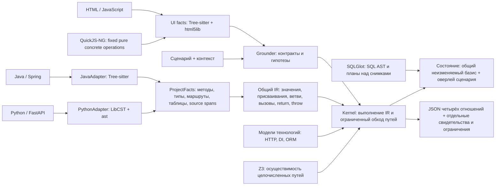

# Общее ядро варианта № 13

Реализован первый срез архитектуры из исследования 17.10.2026: два разных языка сводятся к операциям одного интерпретатора. Парсеры, лексические области Python, SQL-планы и решатель ограничений используют готовые открытые проекты. Код прежних вариантов не импортируется. Версии, лицензии и места интеграции перечислены в [THIRD_PARTY.md](THIRD_PARTY.md).

## Границы модулей

| Модуль | Ответственность |
| --- | --- |
| `ir.py` | Структуры операций, параметров, методов, типов и маршрутов; JSON-представление кеша |
| `java.py`, `python.py` | Разбор деклараций и ленивое понижение тел в один IR |
| `project.py` | Факты проекта, соответствие входным ID, наследование, поиск реализации, ключ кеша |
| `values.py` | Неизвестные значения, типизированные символы, составной символический текст, объекты и ответы |
| `kernel.py` | Единственный исполнитель выражений, управления, вызовов и исключений |
| `constraints.py` | Мост формул IR к Solver, Int и BitVec Z3; счётчики и безопасный отказ от отсечения |
| `python_names.py` | LibCST QualifiedNameProvider, ScopeProvider, позиции и совместимость синтаксиса в памяти |
| `sql.py`, `sql_queries.py` | SQLGlot: лексер и AST контекста; upstream optimizer/planner/executor для проверенного SELECT-подмножества |
| `models.py`, `protocol.py` | Контракты библиотек, HTTP, привязка параметров, DI, операции таблиц |
| `state.py` | Изолированные сценарии и оверлеи таблиц; ограниченное чтение SQL/JSON |
| `ui.py`, `ui_extract/` | Исходные UI-контракты, QuickJS-NG для конкретных выражений, отдельный браузерный кадр и мост к общему HTTP |
| `grounding.py`, `input_context.py` | Rank-BM25, лексические гипотезы, контекстные span и значения с происхождением; явные HTTP-запросы |
| `analysis.py` | Обход альтернатив, бюджет, проекция рёбер и свидетельства |

IR не содержит объектов Tree-sitter или Python AST. В ядре нет импортов парсеров. Тег языка сохраняет различия переполнения, деления, областей видимости и истинности. Одна и та же реализация ветвей, состояния, вызовов, исключений и HTTP применяется к обоим адаптерам. Модели технологий пока собраны в двух небольших модулях; реестра версионированных model packs ещё нет.

## Правила неопределённости

`Unknown` содержит причину и происхождение; обычный `bool(Unknown)` запрещён. Неизвестное условие создаёт альтернативы. Неподдержанная конструкция прекращает исследуемый хвост с диагностикой. Внешний вызов без модели допускает нормальный и исключительный исход и инвалидирует доступное состояние. Это намеренно грубое приближение.

Типизированные неизвестные целые и булевы параметры получают устойчивые символы. Формулы сохраняют связи между повторными условиями и присваиваниями. Z3 проверяет обе альтернативы относительно накопленных ограничений; исключается только UNSAT. Таймаут, unknown и ошибка неподдержанного кодирования сохраняют альтернативы и отражаются в solver.failures. По умолчанию один вызов решателя ограничен 50 мс, параметр — --smt-timeout-ms. --no-smt отключает отсечение для сравнения. Java int/long кодируются знаковыми 32/64-битными векторами с переполнением и SRem; целые Python — Int с его floor-делением. Исключение при нулевом делителе рассматривается до построения формулы. После HTTP-перехода сравнения используют язык получателя. Nullable, float/IEEE754 и строки в этот проверенный срез не входят.

LibCST разрешает import aliases и лексические области; имя, присваиваемое внутри Python-функции, не подменяется одноимённым импортом до своего присваивания. Новый синтаксис except A, B: нормализуется в памяти через CST, сохраняя исходный файл. Это устранило parse error в текущем FastAPI Template на хосте Python 3.11. Остальной Python 3.14 автоматически поддержанным не считается.

Символический UUID сохраняет идентичность при JSON-передаче и построении URL. Он не заменяется известной строкой вроде `symbolic-1`. Символический текст хранится как части; неизвестная структура URL диагностируется отдельно. Объекты сохраняют алиасы внутри пути.

Для каждого сценария создаётся независимое состояние поверх общей исходной базы. Записи копируются при изменении; клоны не копируют весь неизменяемый SQL-дамп. Бюджеты ограничивают пути, попытки разветвления, операции, глубину и циклы. Достижение бюджета означает неизвестный хвост. Кешируются только пониженные тела IR; конечные ответы и состояния не кешируются.

SQLGlot читает CREATE/INSERT с именованными или позиционными колонками, квалифицированные и quoted-имена, комментарии и строковые разделители. Десятичные литералы контекста сохраняются как Decimal. Неизвестная мутация инвалидирует снимок; неподдержанный INSERT не доказывает пустоту таблицы. MySQL versioned comments обрабатываются отдельно от строк; LOCK/UNLOCK и переключение индексов не считаются изменением строк. Для исходников поддержаны JDBC queryForList/queryForObject, literal native @Query и SQLAlchemy text/execute. Их проверенное SELECT-подмножество выполняет сам SQLGlot над переданными таблицами в памяти: JOIN, WHERE, GROUP, ORDER, COUNT и простые проекции. Допустимые узлы AST ограничены, неизвестные параметры/типы/планы диагностируются, стоимость ограничивается произведением размеров входных таблиц и общим бюджетом. Подключения к БД нет. JPQL, CTE, произвольные функции, символьные SQL-параметры и полная числовая семантика СУБД не реализованы.

У модели Session add/delete формируют отложенные изменения. Ребро data появляется при flush/commit или чтении; происхождение отложенной записи сохраняется из метода, поставившего её в очередь. Flush меняет оверлей транзакции, commit переносит его в базис сценария, rollback/close отбрасывает. Автоматический dirty tracking без add, полная identity map SQLAlchemy, каскады, expire, конкурирующие транзакции и ограничения БД не покрыты. Source Session без engine завершается UnboundExecutionError до data-эффекта. Типизированная Session, предоставленная проверкой как готовое предусловие, считается привязанной. Проверки такого тела не доказывают полный lifecycle реального приложения.

Значение ключа IR-кеша включает все исходники, скелет, доступную конфигурацию, profiles, код модели и версии подключённых компонентов. Любая правка этих входов инвалидирует кеш целиком. Это корректный консервативный кеш, а не полный инкрементальный индекс. Изменение данных перечитывается при каждом анализе. На маленькой интеграционной проверке выигрыша по общему времени от кеша не измерено.

## Проекция результата

Политика `may` зафиксирована до проверки публичных корпусов: в ответ попадает объединение наблюдённых моделью рёбер. `--policy must` оставляет пересечение полностью исследованных путей. При необследованном хвосте `must` пуст. У каждого экспортированного ребра есть исходная позиция и правило.

`must` условно относительно предоставленных значений, выбранного контракта и поддержанной модели. `may` не является доказанной полной верхней оценкой программы: непрозрачный код может иметь дополнительные эффекты. Оба ограничения явно записаны в отчёте. Одного итогового JSON недостаточно для оценки определённости.

Неоднозначное связывание действия с API сохраняет альтернативы. Явный запрос в шаге и ссылка `{"$ref":"steps.1.body.id"}` позволяют отделять ошибку извлечения сценария от ошибки исполнения. Это дополнение к текстовым сценариям, а не замена обязательного входного формата организаторов. ID сценария используется только при формировании `scenario:<id>`.

## Проверенный срез поддержки

Java: методы и простые классы/интерфейсы, часть наследования и DI, обычные выражения, целочисленная арифметика int/long, короткое замыкание, области блоков, циклы с бюджетом, switch, return/throw/catch/finally. Spring: основные аннотации маршрутов, параметры, ResponseEntity, стандартная политика RestTemplate, ограниченные Spring Data CRUD/derived queries и rollback простого `@Transactional`. Python: функции, часть объектов/свойств, аргументы, коллекции, ветви, циклы, исключения, await, ленивое создание корутин/генераторов. FastAPI: APIRouter/include_router, вложенные префиксы, Depends и отказ до обработчика, простые схемы SQLModel, Session CRUD/commit/rollback, select/where.

Модели не заменяют полные JVM, Python, ORM и фреймворки. Не покрыты произвольные декораторы/метаклассы/monkey patching, остальной новый Python-синтаксис, lambdas/Streams и сложная Java-семантика, JVM/SQL исключения и ограничения, ORM lazy loading/relationships/cascades, произвольные запросы, полная транзакционная модель и сериализаторы. Часть конструкций диагностируется непосредственно; полнота обнаружения всех таких границ не доказана.

Фильтры и security lifecycle пока обнаруживаются как неполная фаза: ядро допускает прекращение до обработчика и не подтверждает его безусловно. Очистка генераторных зависимостей неизвестна и инвалидирует состояние для последующих запросов. Пользовательское предусловие `assumptions.framework_entry=true` означает условный анализ после этой фазы. Это не подтверждение безопасности или полного HTTP-трассирования.

Лексический Grounder пока существенно слабее накопленного связывания Java/UI в № 11. Ограниченный браузерный мост описан в [UI.md](UI.md); полный lifecycle, составные действия и callback chains остаются открыты. Локальный reranker, точные summaries с footprint, fixpoint/widening, выборочная инкрементальная инвалидация и дополнительные языки ещё не реализованы. Результаты не дают основания объявить универсальный анализатор любого языка готовым.

## Дополнительные границы состояния и сериализации

Непрозрачный вызов обесценивает также изменяемые dict/list/set и их алиасы в локальных окружениях, глобальные значения и ещё не материализованные значения модулей. Контейнеры помечаются по идентичности; последующие чтения не восстанавливают их из старого литерала. Это грубая инвалидация без точного footprint.

Нелитеральные значения Python module globals и default arguments относятся ко времени определения до сценария. Они берутся из явно предоставленного globals-контекста либо остаются неизвестными. Их фабрики не запускаются повторно в трассе сценария. Чистые литералы и составные литеральные выражения поддержаны; полный порядок инициализации модулей/классов не реализован.

Цикл или превышение глубины сериализации не обрушает анализатор. Для ответа выдаются диагностика и неизвестный HTTP-статус; исходящий непредставимый body останавливает неизвестный хвост до добавления remote. Диагностический JSON имеет собственную защиту от циклов/глубины. Это не полная модель Jackson/Pydantic/JSON и пользовательских сериализаторов.

Для FastAPI подтверждённая очерёдность сейчас ограничена декларациями одного файла в одной группе регистрации router/mount. Пересекающиеся разные группы и модули остаются гипотезами с registration-order-unknown; алфавитный порядок файлов не считается порядком исполнения. Java final bindings сохраняют неизменяемость ссылки, но изменяемое содержимое по-прежнему обесценивается. Неизвестный static initializer не подменяется нулевым значением.

## Проверенный второй этап

Идентичные регулярные Python-пакеты разных deployment получают отдельные пространства имён. LibCST продолжает разрешать лексические связи внутри каждого сервиса. Это не полная модель import roots/namespace packages или повторного объявления одного имени.

Rank-BM25 строит отдельные индексы сигнатур и точных границ тела метода. Соседний метод не попадает в его документ. Используется upstream BM25Plus с delta=0; методы с одинаковыми признаками относительно запроса остаются альтернативами даже при различии длины нерелевантного текста. Лексический выбор всегда отмечается как гипотеза и partial. Контекстные цитаты и явно переданные inputs имеют отдельное происхождение. Описания последующих действий не становятся литералами текущего шага.

Первый контракт с проверкой версии — мутабельность HttpEntity.getHeaders. Явная версия org.springframework извлекается из прямых зависимостей/dependencyManagement Maven и локальных свойств либо передаётся в context.framework_versions по deployment. Неподдержанная версия оставляет обе альтернативы; выбранная политика сохраняется на объекте. Полного разрешения зависимостей Maven/Gradle, Boot BOM и профилей нет. На HTTP-границе заголовки копируются, а политика библиотеки заново относится к клиентскому deployment. Возвращаемые read-only list views пока прекращают неподдержанный хвост с диагностикой. Это ограниченный контракт, а не полная модель HttpHeaders.

## Проверенный третий этап

Общее ядро принимает запрос, вычисленный по исходному UI, и возвращает значение в браузерный кадр. Backend Symbol проходит через отдельный тег UI и абстрактный JSON без конкретизации. QuickJS-NG получает только фиксированную операцию и конкретные значения; непрозрачные символы в него не сериализуются как придуманные строки. Целое выражение data валидируется до HTTP binding, JSON и form имеют разные контракты. Поддержанные completion checks учитывают исключения/return до последующего эффекта.

JavaScript не понижается в backend IR целиком. Сейчас это отдельный ограниченный экстрактор и вычислитель; полного единого интерпретатора трёх языков здесь нет. Сквозной синтетический пример прошёл по всем четырём отношениям, публичный полный HTTP/security/UI-эталон ещё отсутствует. Ключ кеша включает UI-исходники, вложенный код адаптера и новые версии зависимостей. Подготовка UI пока повторяется между CLI-процессами.

## Проверенный четвёртый этап

FastAPI, Pydantic/pydantic-core, PyJWT и pwdlib подключены как исполняемые доверенные библиотеки. HTTP-тело, OAuth2 form, Bearer, подпись/claims и конкретная сериализация используют upstream-семантику; адаптеры переводят её в значения и исключения общего ядра. Четыре ключевых файла побайтно сверены с закреплёнными GitHub-тегами. Исследуемый Python не импортируется; фабрики приложения по-прежнему исполняются только IR. Часы JWT задаются контекстом; порядок native-проверок и типы исключений сохранены.

Явная начальная конфигурация участвует в извлечении префиксов маршрутов и fingerprint. Schema cache разделён по исходным глобальным значениям; поздняя мутация глобального имени не меняет уже определённые ограничения класса. Native-фабрики не захватывают движок предыдущего сценария. Source-определение с именем библиотечной фабрики не воспроизводится как инициализация сценария.

На неизменённом публичном FastAPI Template проверена цепочка из семи HTTP-запросов, исходные dependencies, JWT, CRUD, response projection и состояние до 404. Всего 8 HTTP-случаев повторяются offline CLI без подготовленных User/Session; эталон Codex задан заранее. Граф основной цепочки содержит 13 executes, 5 calls, 6 data, пустой remote. Это дополняет синтетическую смешанную интеграцию, но не заменяет публичную Java/Spring цепочку или полный путь от естественного языка/UI. Внутренние конструкторы Source-моделей и произвольный lifecycle пока имеют более узкие контракты. Подробности, границы и воспроизведение — [FASTAPI.md](FASTAPI.md).

## Пятый этап: конфигурация и границы Spring

Конфигурация индексируется отдельно по deployment через javaproperties и PyYAML. Поддержаны conventional classpath `application`/`bootstrap`, простые селекторы профилей и локальные Maven-parent ссылки для определения поколения Boot. Для внешней конфигурации принимается полный упорядоченный снимок Spring Environment в `context.configuration`. Более ранний propertySource имеет приоритет; исходный контекст копируется и участвует в fingerprint. Смена снимка после создания Project требует переиндексации. Config Server, Maven и код приложения не запускаются. Произвольные ConfigData imports, locations, profile groups и DispatcherServlet path остаются вне модели.

Адаптер Java индексирует методы внутри тела enum; создание значений enum пока не реализовано. Feign-интерфейс сохраняет proxy-поведение: наличие исходного fallback не делает его реализацией для успешного вызова. Отказ с fallback останавливает неподдержанный хвост, пока нет отдельного lifecycle-контракта.

Ограниченная Bean Validation выполняется до контроллера. Из исходников берутся field-аннотации, Default-group null/size/integer bounds и каскады; Pydantic проверяет численные границы, UTF-16 длину вычисляет CPython codec. Custom/getter validators и группы требуют отдельной модели. Исключение может выбрать исходный локальный обработчик или ControllerAdvice по проверенному типу, приоритету и Order. Callback исполняется через IR без выдуманного прямого calls от контроллера. Неизвестные типы, selectors и дополнительная lifecycle-семантика сохраняют ограничения.

Для выбранных Java time-операций используются CPython datetime/zoneinfo и закреплённая IANA. Время и default timezone передаются явно. Региональные зоны требуют `timezone_database=2026e`; nanoseconds, расширенные годы и неизвестный HTTP codec останавливают неподдержанный хвост. Это не реализация `java.time` целиком. Публичная цепочка записи статистики по-прежнему не проходит; её полный ручной целевой граф, предусловия и наблюдаемый префикс сохранены рядом с успешными проверками.
